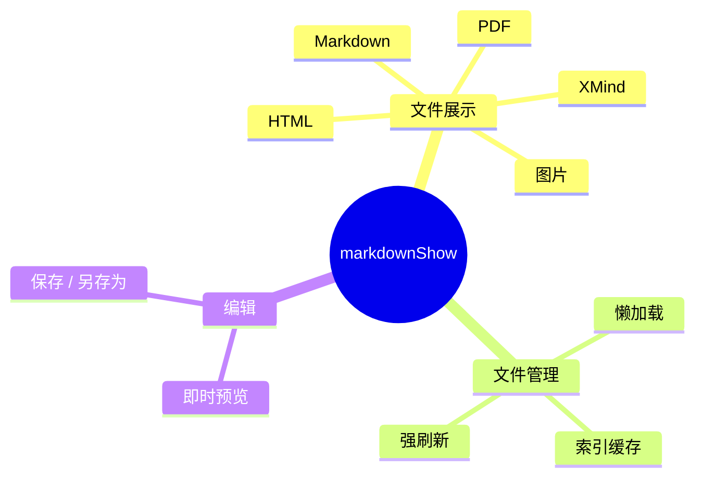

<!-- [skill: go-team-standards · 迁移] 公开正文迁移，保留原文与来源标识。 -->

> 这篇文章本身就是一个 `.md` 文件。你现在看到的图片、下面的内联 HTML 卡片、还有那些 Mermaid 图，全都是 markdownShow 直接渲染出来的——这正是我想让它做到的事。

## 缘起：一个"拖进去就能看"的小工具

一开始，markdownShow 只做一件事：**把 `.md` 拖进浏览器，立刻渲染**。代码高亮、目录 TOC、亮/暗主题、Mermaid 图表，再加一层 DOMPurify 防脚本注入——一个纯前端、零后端、能装成 PWA 的 Markdown 查看器，部署在 GitHub Pages 上。

它够用，但有个我越用越明显的痛点：**我的文件夹里不只有 md**。还有 PDF 报告、单页 HTML 计算器、一堆截图、XMind 导出的思维导图。每次看它们都得切到别的应用。于是我打开 Claude Code，开始把这个"只能看 md 的工具"，改造成"我本地文档的统一查看器"。

## 我是怎么和 Claude Code 协作的

我的节奏很简单，也一直这么要求它：

-   **一次只做一件事**，做完立刻汇报，别一口气堆一堆；
-   **不许臆测**——改之前先看代码、先复现，改完要真的跑测试、真的在浏览器里验证；
-   有坑如实说，跳过了哪步也要讲清楚。

它写的纯逻辑都带 `node --test` 单元测试，UI 改动会起本地服务、用浏览器实际点一遍再给我看截图。整个过程更像是结对编程，而不是"甩需求等结果"。

## 一步步长出来的能力

  
**点开看：这一版加了哪些东西**（这段是内联 HTML，也能正常展开）

-   🗂 **本地文件夹管理**——浏览、搜索、新建/重命名/删除
-   📄 **PDF 展示**、🌐 **HTML 预览**、🖼️ **图片查看**、🧠 **XMind 思维导图**
-   ✏️ **编辑模式**——左边写、右边即时预览，能存回原文件

### 1\. 先让它能管我的文件夹

第一步是接入浏览器的 File System Access API：选一个本地目录，在侧边栏里以树状浏览。听起来简单，却踩了这次最深的一个坑。

我选了一个近 3000 个文件的真实项目目录，结果**只能看到第一层**。Claude Code 没有瞎猜，而是去复现、去读代码，最后定位到根因：旧实现是"一次性递归扫完整棵树"，任何一个子目录读取失败（权限、特殊目录）就会让整棵树崩掉；而且几千个文件一次性读盘，界面直接卡住。

修法是重构成**懒加载**——打开只读第一层，点开某个目录才读那一层；单个目录出错只标记它自己，不拖垮全局。顺手加了 `localStorage` 索引缓存和"强刷新"。这条演进大概长这样：

### 2\. 不只是 md：把 PDF / HTML / 图片 / XMind 都接进来

这是我最想要的部分，也是这篇博客的主角——**md 后面，终于能看别的了**。

我们引入了"文档类型"的概念，按扩展名分派渲染：

<table><thead><tr><th>类型</th><th>怎么渲染</th><th>关键点</th></tr></thead><tbody><tr><td>Markdown</td><td>marked + DOMPurify</td><td>原有主力</td></tr><tr><td>PDF</td><td><code>&lt;iframe&gt;</code> + blob URL</td><td>直接用浏览器原生阅读器</td></tr><tr><td>HTML</td><td>沙箱 <code>&lt;iframe&gt;</code></td><td><code>allow-scripts</code> 但<strong>不</strong>给 <code>allow-same-origin</code>，脚本能跑却读不到本站数据</td></tr><tr><td>图片</td><td><code>&lt;img&gt;</code> + blob URL</td><td>复用已有的点击放大</td></tr><tr><td>XMind</td><td>解 zip → 转 Mermaid</td><td>见下</td></tr></tbody></table>

**图片**这一栏值得单独说——你往上翻，文章顶部那个 logo 就是图片；markdownShow 现在不光能渲染 md 里内联的图片，还能直接打开本地的 `.png/.jpg/.svg/...` 当独立文档看，并点击放大。

**HTML** 我特别在意安全：那些从别处拿来的单页 HTML（比如带脚本的计算器），我希望能跑起来交互，但绝不能让它碰到我这个站点的数据。答案是沙箱 iframe——给 `allow-scripts` 让它能动，却故意不给 `allow-same-origin`，把它隔离成一个独立源。

**XMind** 是最有意思的一个。`.xmind` 其实是个 zip 包，里面藏着 `content.json`。我不想为它引入一个几百 KB 的解压库，于是用了浏览器原生的 `DecompressionStream('deflate-raw')` 自己解，再把主题树转成 **Mermaid 的 mindmap 语法**，直接复用项目里早就有的 Mermaid 渲染管线。等于说，思维导图这个功能，几乎没写渲染代码：

上面这张图，如果来自一个真实的 `.xmind` 文件，效果一模一样——因为它们最后走的是同一条渲染路。

### 3\. 能看，还要能改

最后一步是编辑模式。我要的是经典的**左边写、右边即时预览**：改一个字，右侧防抖 160ms 就重渲染，而且预览独立滚动、打字不跳顶。

存盘用 File System Access 的可写句柄：**保存**直接写回原文件（第一次会申请一次写权限），**另存为**用 `showSaveFilePicker` 存成新文件并接管句柄。拖进来的文件因为没有句柄，就自动引导走"另存为"——这是浏览器的安全边界，不是 bug，我们如实标注了出来。

## 我的一点技术偏好：能不引依赖就不引

回头看，这一版新增的能力里，**没有引入任何新的第三方库**：

-   PDF / HTML / 图片：浏览器原生 `iframe` / `img` + blob URL；
-   XMind 解压：原生 `DecompressionStream`；
-   思维导图：复用已有的 Mermaid；
-   文件读写：原生 File System Access API。

纯前端、零后端、零新依赖，还是那个能装到桌面的 PWA。它长大了，但没变重。

## 写在最后

从"只能看 md"到"md、PDF、HTML、图片、XMind 都能看，还能就地编辑"，是我和 Claude Code 一步一个 commit 磨出来的。每一步都先复现、再动手、跑完测试才敢说"做好了"。

而你正在读的这篇文章，就是它的成果单：**一个 Markdown 文件，装下了图片、内联 HTML、还有思维导图**——这，就是我想要的 markdownShow。
