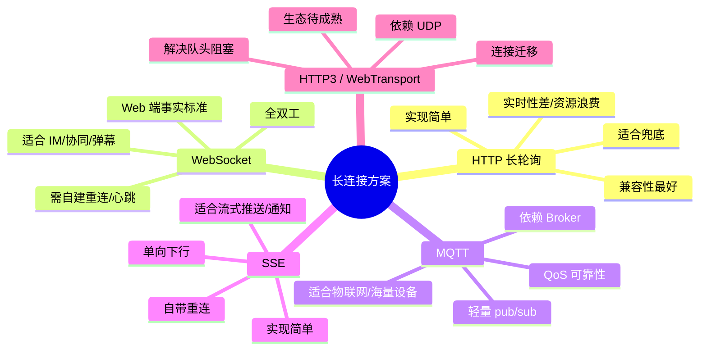
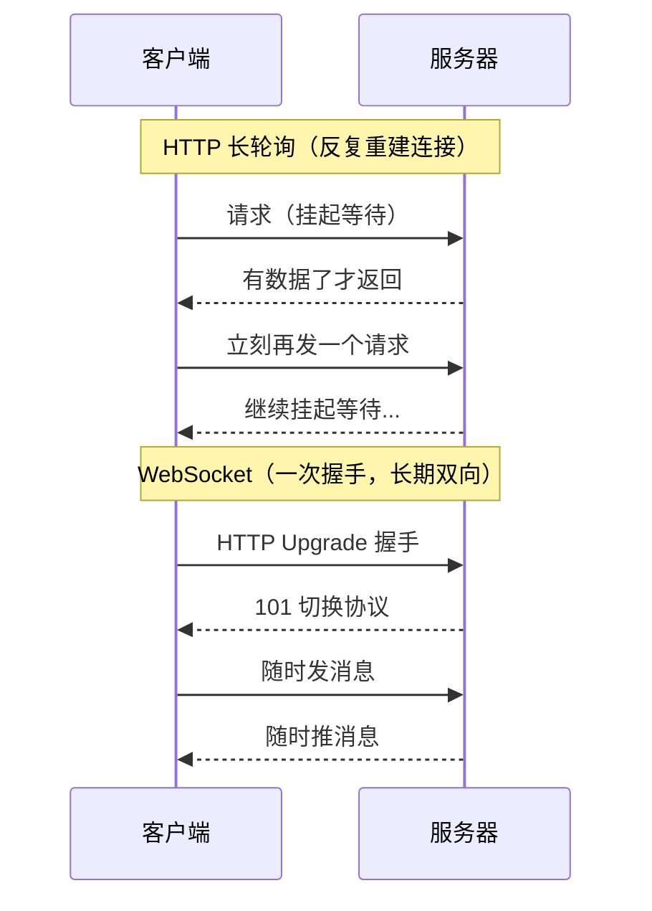
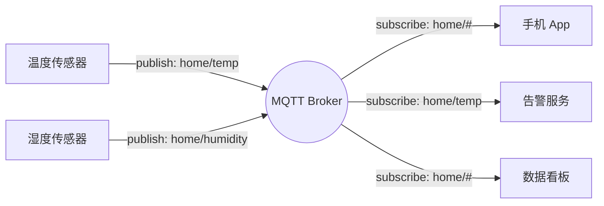
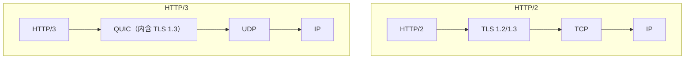
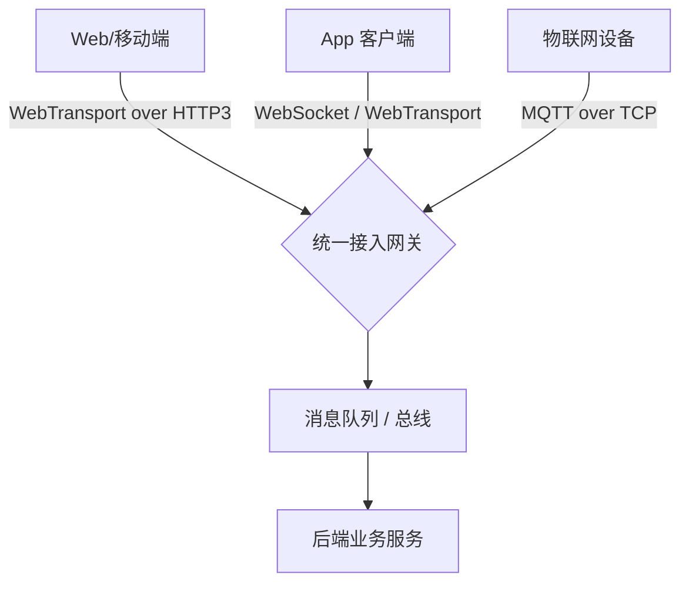

<!-- [skill: go-team-standards · 迁移] 公开正文迁移，保留原文与来源标识。 -->

> 写在前面：这篇是我自己整理长连接这块时记的笔记，不算特别专业，更多是工程视角的"大白话版"。如果你正在做实时推送、物联网、IM 这类需要保持长连接的活儿，希望能给你一点参考。

## 关于我

一个普通后端开发，平时主要写服务端，偶尔也碰点前端和嵌入式。最近因为项目上需要做实时推送，把几个长连接方案都摸了一遍，顺手把学到的和踩到的记下来，整理成这篇笔记。

不算什么专家，就是把自己理解的东西用大白话讲一遍，有说得不对的地方欢迎指正。

* * *

## 一、先说结论：没有银弹

长连接协议的选型，本质上是在**实时性、可靠性、资源开销、网络穿透能力、生态成熟度**这几个维度之间做权衡。没有哪个方案是全能的，脱离场景谈"哪个最好"都是耍流氓。

先放一张全景图，帮你建立个整体印象：

下面我把主流的几个方案挨个过一遍。

* * *

## 二、主流方案逐个聊

### 1\. HTTP 长轮询 / 短轮询（Polling）

最古老、最朴素的方案。客户端隔一段时间问一次服务器"有没有新消息"，或者发个请求挂在那等服务器有数据了再返回（长轮询）。

**优点**

-   实现简单，纯 HTTP，任何环境都能跑
-   防火墙、代理几乎不会拦
-   不需要特殊的服务端支持

**缺点**

-   实时性差，短轮询有延迟，长轮询也有连接重建的开销
-   浪费资源，大量无效请求，服务器扛连接很吃力
-   HTTP 头部开销大，每次请求都带一堆 header

**适用场景**

-   实时性要求不高、又懒得上复杂方案的小项目
-   对兼容性要求极高、连 WebSocket 都可能被掐断的恶劣网络环境（兜底方案）

> 说实话，现在新项目基本不会主动选它了，更多是作为降级兜底。

下面这张图能直观看出长轮询和真正的全双工长连接的区别——长轮询是"一问一答还得反复重连"，而 WebSocket 是"建好一条管子双向随便聊"：

* * *

### 2\. WebSocket

目前 Web 端实时通信的事实标准。基于 TCP，通过 HTTP 升级握手建立全双工通道。

**优点**

-   全双工，双向实时，延迟低
-   复用 HTTP 基础设施（走 80/443，握手就是个 HTTP Upgrade）
-   浏览器原生支持，前端友好
-   防火墙穿透能力还不错（尤其 wss 走 443）

**缺点**

-   协议本身不管重连、心跳、保活，这些都得自己撸（断网检测、指数退避、心跳包……）
-   没有 QoS，断线期间的消息会丢，得在应用层做补偿
-   没有内置的发布/订阅，多端广播、topic 订阅要自己在上层搭
-   长连接占服务器资源，海量连接时扩展和负载均衡（粘性会话）比较头疼

**适用场景**

-   Web 端的 IM、协同编辑、实时弹幕、在线游戏、行情推送
-   凡是「浏览器要实时收发」的，基本首选

* * *

### 3\. MQTT

为物联网而生的轻量发布/订阅协议，基于 TCP（也能跑在 WebSocket 上）。

它和前面几个最大的不同是：通信不是端到端的，而是所有人都连到一个 Broker（消息中转站），通过 topic 来收发——这也是它能轻松支持一对多的根本原因：

**优点**

-   极轻量，头部最小才 2 字节，特别适合低带宽、弱网、省电的设备
-   原生发布/订阅模型，天然支持一对多、topic 订阅
-   有 QoS 分级（0/1/2），可以按需保证消息送达
-   支持遗嘱消息（Last Will）、保留消息、持久会话，断线场景考虑得很周到

**缺点**

-   强依赖 Broker，是潜在的单点和性能瓶颈，集群方案不如 HTTP 生态成熟
-   QoS 1 会有重复消息（要做幂等），QoS 2 开销和延迟都大
-   默认端口（1883/8883）常被企业防火墙拦，不易被 HTTP 代理转发
-   没有原生的请求-响应模型（5.0 之前做起来很别扭）
-   payload 是裸字节，没 schema，格式得自己约定

**适用场景**

-   物联网设备接入：传感器、智能家居、车联网、工业网关
-   海量设备、低功耗、弱网环境
-   需要发布/订阅和消息可靠性的推送系统

> 我自己的体感：设备一旦上了一定规模，且网络环境复杂，MQTT 的稳定性和省资源确实明显。但 Broker 的运维（集群、监控、消息堆积清理）也得花心思。

* * *

### 4\. SSE（Server-Sent Events）

经常被忽略的一个方案。基于 HTTP，服务器单向往客户端推数据流。

**优点**

-   实现简单，就是个长连接的 HTTP 响应流
-   浏览器原生支持，自带自动重连
-   走 HTTP，穿透性好

**缺点**

-   只能单向（服务器→客户端），客户端要发数据还得另开请求
-   老的 HTTP/1.1 下有浏览器并发连接数限制（HTTP/2 缓解了）
-   二进制支持弱，主要是文本

**适用场景**

-   只需要服务器单向推送的场景：消息通知、实时日志、AI 流式输出、股价/进度推送

> 现在很多 AI 应用的"打字机效果"流式输出，底层就是 SSE。单向推送场景下，它比 WebSocket 简单得多。

* * *

## 三、横向对比一张表

<table><thead><tr><th>维度</th><th>长轮询</th><th>WebSocket</th><th>MQTT</th><th>SSE</th></tr></thead><tbody><tr><td>通信方向</td><td>半双工</td><td>全双工</td><td>全双工(pub/sub)</td><td>单向(下行)</td></tr><tr><td>实时性</td><td>一般</td><td>高</td><td>高</td><td>高</td></tr><tr><td>资源开销</td><td>高</td><td>中</td><td>低</td><td>中</td></tr><tr><td>消息可靠性</td><td>无</td><td>无(需自建)</td><td>有 QoS</td><td>弱</td></tr><tr><td>发布订阅</td><td>无</td><td>无</td><td>原生</td><td>无</td></tr><tr><td>防火墙穿透</td><td>极好</td><td>好</td><td>一般</td><td>好</td></tr><tr><td>浏览器支持</td><td>原生</td><td>原生</td><td>需 over WS</td><td>原生</td></tr><tr><td>典型场景</td><td>兜底</td><td>Web 实时交互</td><td>物联网/海量设备</td><td>单向流式推送</td></tr></tbody></table>

* * *

## 四、HTTP/3 来了，它解决了什么？

聊到这，绕不开 HTTP/3。它基于 QUIC（跑在 UDP 上），对长连接来说有几个真正动人的特性：

先看一眼它和 HTTP/2 在协议栈上的根本区别——HTTP/3 把传输层从 TCP 换成了基于 UDP 的 QUIC，TLS 也被合进了 QUIC 里：

**1\. 干掉了队头阻塞（Head-of-Line Blocking）**  
HTTP/2 虽然多路复用，但底层还是一条 TCP，只要丢一个包，后面所有的流都得排队等。HTTP/3 的多个流相互独立，丢包只影响那一条流。弱网下体验差距很明显。

**2\. 连接迁移（Connection Migration）**  
这是杀手级特性。QUIC 用 Connection ID 而不是 IP 四元组来标识连接。手机从 WiFi 切到 5G、IP 变了，连接居然不断，也不用重新握手。对移动端长连接来说，这简直是梦寐以求。

**3\. 更快的握手**  
传输层握手和 TLS 握手合并，首连 1-RTT，重连甚至 0-RTT，比传统 TCP + TLS 快一截。

**4\. 强制加密**  
内置 TLS 1.3，安全性是默认项。

### 但是——别急着 all in

HTTP/3 也有它的现实问题：

-   **UDP 被封/限速**：不少企业防火墙、运营商对 UDP 不友好甚至直接 ban，这时只能回退到 TCP。受限网络里这是真实痛点。
-   **CPU 开销更高**：QUIC 在用户态实现，加解密、拥塞控制都吃 CPU，内核优化远不如几十年沉淀的 TCP，海量连接时服务器成本是笔实账。
-   **生态还在追赶**：服务端（nginx 的 HTTP/3 还比较新）、负载均衡、监控、抓包排错的工具链，成熟度都不如 TCP。
-   **它不直接替代 WebSocket/MQTT**：HTTP/3 优化的是"管道"质量，你还是需要上层的推送机制。真正对标 WebSocket 的是 **WebTransport**（基于 HTTP/3，支持双向流 + 不可靠数据报，可以看作 WebSocket 的下一代），以及 RFC 9220 定义的 **WebSocket over HTTP/3**。

> 一句话总结：**HTTP/3 优化的是「管子」，MQTT / WebSocket 解决的是「怎么往管子里推消息」，它们不是互斥的，而是可以叠在一起的。**

* * *

## 五、对未来的一点畅想

写到这，想聊点不那么"技术参数"的东西。

我个人是挺看好 HTTP/3 + WebTransport 这条路线的，尤其是连接迁移这个特性，对移动互联网时代的长连接体验是质的提升。理想中的未来可能是：**Web 端用 WebTransport（HTTP/3），设备端用 MQTT，两边在网关层汇聚**——各取所长：

这么搭的好处是：前端享受 HTTP/3 的抗弱网和切网优势，设备端继续用省电可靠的 MQTT，网关层把协议差异屏蔽掉，后端只面对统一的消息总线。

但技术演进从来不只是技术问题。HTTP/3 要真正普及，**最大的变量其实是「生态配合」**：

-   **运营商和网络设备厂商**得对 UDP 更友好，别动不动就限速封禁，否则 QUIC 永远在"回退到 TCP"的路上。
-   **CDN 和云厂商**得把 HTTP/3 的支持做成默认开箱即用，而不是要用户费劲折腾配置（好在 Cloudflare、Google、各大云已经在推了）。
-   **中间件和负载均衡**得跟上，Nginx、Envoy 这些得让 HTTP/3 像今天用 HTTP/2 一样顺手。
-   **可观测性工具链**得补齐，QUIC 加密了一切，抓包排错比 TCP 难得多，没有趁手的工具，出了线上问题会很抓狂。
-   **浏览器和客户端 SDK**得把 WebTransport 的 API 打磨成熟、文档完善，降低开发者上手门槛。

这些不是某一家厂商能单独搞定的，需要整个产业链一起往前推。就像当年从 HTTP/1.1 到 HTTP/2，也是 Google 先用 SPDY 趟路、再标准化、再生态跟进，花了好几年才铺开。

所以我的判断是：**HTTP/3 在「能用 UDP 的、对体验敏感的、移动端为主的」场景里会越来越主流，但完全取代 TCP 系（包括 MQTT over TCP）还需要相当长的时间，可能五年十年都未必彻底**。在那之前，老老实实做好降级兜底、按场景混搭，才是工程上稳妥的姿势。

技术这东西，新的不一定立刻就好用，旧的也不会马上就死掉。看清自己的场景，比追新更重要。

* * *

## 六、给个简单的选型口诀

-   **浏览器要双向实时** → WebSocket（未来看 WebTransport）
-   **只要服务器单向推** → SSE
-   **海量设备、弱网、省电** → MQTT
-   **极端兼容、要兜底** → 长轮询
-   **移动端、对弱网和切网敏感、UDP 可用** → 关注 HTTP/3 / WebTransport
-   **拿不准** → 先 WebSocket 起步，遇到瓶颈再针对性换
