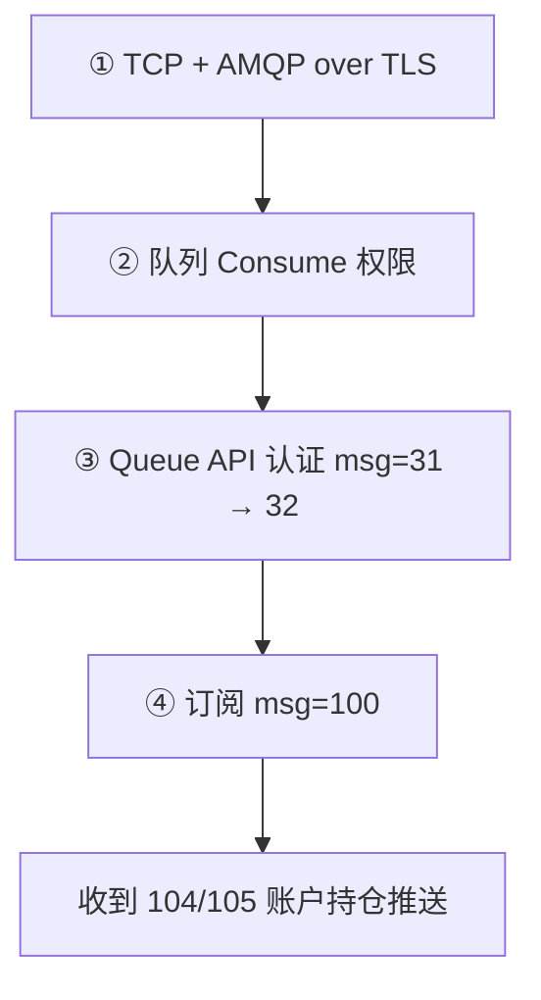

<!-- [skill: go-team-standards · 迁移] 公开正文迁移，保留原文与来源标识。 -->

> **场景**：衍生品对冲侧通过 RabbitMQ 接入桥方（CFD 流动性桥）的 Queue API，订阅对冲账户的余额与持仓推送。  
> **栈**：Go + `github.com/rabbitmq/amqp091-go` + 长驻消费者进程 + 结构化诊断日志（`[CFD-MQ-DIAG]`）。  
> **核心结论**：MQ「能连上」≠「能消费」≠「能认证」≠「能收推送」——**四层要分开验证，分开记日志**。

* * *

## 1\. 先建立正确的心智模型

### 1.1 两套凭证、两层协议

这是整个联调中最容易踩的坑：**RabbitMQ 传输层凭证**和**Queue API 应用层凭证**是两套完全独立的账号体系。

<table><thead><tr><th>层级</th><th>用途</th><th>账号示例（脱敏）</th><th>配置项</th></tr></thead><tbody><tr><td><strong>RabbitMQ 传输层</strong></td><td>TCP/TLS 建连、<code>Publish</code> / <code>Consume</code></td><td><code>mq_client_user</code></td><td><code>CFD_MQ_USER</code> / <code>CFD_MQ_PASSWORD</code></td></tr><tr><td><strong>Queue API 应用层</strong></td><td>发 <code>msg=31</code> 认证、订阅账户推送</td><td><code>trader@example.com</code>（客户端登录邮箱）</td><td><code>CFD_MQ_API_USERNAME</code> / <code>CFD_MQ_API_PASSWORD</code></td></tr></tbody></table>

**踩坑 #1**：把 RabbitMQ 密码填进了 `CFD_MQ_API_PASSWORD`。  
此时桥方 RabbitMQ 日志会显示 `authenticated and granted access`（传输层 OK），但 Queue API 仍会用 **msg=30 明确拒绝**。两边日志看起来"互相矛盾"，本质是层级混淆。

### 1.2 四个阶段，逐级解锁



每一层失败的表现都不同，**绝不能拿上一层 OK 推断下一层 OK**。诊断工具和日志也必须按层拆开输出。

### 1.3 与桥方对齐过的配置（脱敏示例）

<table><thead><tr><th>项</th><th>值（示例）</th><th>配置项</th></tr></thead><tbody><tr><td>Host</td><td><code>mq.bridge.example.com:5673</code></td><td><code>CFD_MQ_HOST</code> / <code>CFD_MQ_PORT</code></td></tr><tr><td>VHost</td><td><code>/your_vhost</code></td><td><code>CFD_MQ_VHOST</code></td></tr><tr><td>Exchange</td><td><code>BridgeAPI</code></td><td><code>CFD_MQ_EXCHANGE</code></td></tr><tr><td><strong>Consumer queue</strong></td><td><strong>与 exchange 同名</strong> <code>BridgeAPI</code></td><td><code>CFD_MQ_QUEUE_IN</code></td></tr><tr><td>Routing key</td><td>无独立 rk，直接使用 exchange 名</td><td><code>CFD_MQ_ROUTING_KEY</code> 留空 → 代码回退到 exchange 名</td></tr><tr><td>订阅账户</td><td><code>HEDGE_ACC_01</code>（注意：≠ FIX 链路账户 <code>FIX_ACC_01</code>）</td><td><code>CFD_MQ_SUBSCRIBE_ACCOUNTS</code></td></tr><tr><td>TLS</td><td>必须</td><td><code>CFD_MQ_USE_TLS=true</code></td></tr></tbody></table>

* * *

## 2\. 踩坑时间线（按排查顺序）

### 坑 A：TLS 握手在生产运行时失败，本地却正常

**现象**：本地 CLI 探测脚本 TLS 一切正常；部署到生产容器后约 60s 握手失败。

**原因**：本地与生产的运行时环境不一致——代理、CA 证书、SNI 配置、出口 IP 都可能不同。（原 PHP 项目的版本是 Swoole 协程 hook 干扰了 `stream_socket_enable_crypto`；Go 没有这个问题，但同类教训完全成立。）

**Go 侧正确姿势**：

```go
import (
    "crypto/tls"
    amqp "github.com/rabbitmq/amqp091-go"
)

func dial(cfg Config) (*amqp.Connection, error) {
    tlsCfg := &tls.Config{
        ServerName: cfg.Host, // 显式指定 SNI，避免经 LB/代理时证书校验失败
        MinVersion: tls.VersionTLS12,
        // 切忌为了"先通再说"设置 InsecureSkipVerify: true 然后忘记删
    }
    uri := fmt.Sprintf("amqps://%s:%s@%s:%d%s",
        url.QueryEscape(cfg.MQUser), url.QueryEscape(cfg.MQPassword),
        cfg.Host, cfg.Port, cfg.VHost)
    return amqp.DialTLS(uri, tlsCfg)
}
```

**教训**：**连通性探测必须在与生产相同的运行时/网络环境里跑**。本地过了 ≠ 容器里能过；同时确认出口 IP 是否在桥方白名单内。

* * *

### 坑 B：队列「存在」≠ 能 `Consume`

**现象**：

```
ACCESS_REFUSED - read access to queue 'BridgeAPI' in vhost '/your_vhost'
refused for user 'mq_client_user'
```

而诊断报告同时显示：

```
STEP-04  queue exists => OK
STEP-04b consume      => DENIED
```

**原因**：RabbitMQ 的 **passive declare**（`QueueDeclarePassive`，只检查队列是否存在）和 **`Consume`**（真正读消息）所需的 ACL 权限**不同**。桥方只给了 declare/write，没给 read。

**Go 侧诊断要分两步测**：

```go
// 第一步：队列是否存在（不需要 read 权限）
if _, err := ch.QueueDeclarePassive(queue, true, false, false, false, nil); err != nil {
    report("STEP-04", "queue exists", err) // 队列名错 or 不存在
    return
}
report("STEP-04", "queue exists => OK", nil)

// 第二步：单独验证 consume（需要 read 权限；channel 可能因 ACL 错误被关闭，需新开）
ch2, _ := conn.Channel()
if _, err := ch2.Consume(queue, "diag-probe", false, false, false, false, nil); err != nil {
    report("STEP-04b", "consume => DENIED", err) // ← 唯一 blocker 在这里
    return
}
report("STEP-04b", "consume => OK", nil)
```

**教训**：诊断必须**单独测 `Consume`**，不能只看 queue exists。发给桥方的日志要写清：

> 队列名正确、队列存在，**唯一问题是 consume ACL**。

注意：ACL 错误会**关闭当前 channel**（403 是 channel 级异常），后续操作要重开 channel，否则会被连带报错干扰判断。

* * *

### 坑 C：桥方说了队列名，但问题根本不在命名

**桥方原话**：Queue name same as exchange — `BridgeAPI`。

**我们的误解**：以为还缺一个独立的队列名配置。  
**实际情况**：队列名早已配对，真正卡住的是 consume 权限（坑 B）。

**发给桥方的标准句式**（避免对方往错误方向排查）：

```
Queue name BridgeAPI is CORRECT (queue = exchange).
Queue EXISTS. Publish OK.
ONLY blocker: user mq_client_user has NO read/consume permission on queue BridgeAPI.
```

**教训**：跨团队联调时，日志和措辞要主动**排除已验证项**，只留唯一变量，桥方才能一次改对。

* * *

### 坑 D：先 Publish 认证、后注册 Consumer → 响应被"漏接"

**现象**：`msg=31` 认证请求已成功 publish，但 30 秒内队列「零消息」，迟迟等不到 `msg=32`。

**原因**：桥方响应非常快。如果 `Consume` 注册晚于 `Publish`，`msg=32` 可能在消费者就位之前就已抵达——取决于队列配置（TTL、auto-delete、竞争消费者），这条响应可能永远收不到。

**Go 侧正确顺序**——`Consume` 返回的 delivery channel 必须**先**建立：

```go
// 1. 先注册消费者，拿到 delivery channel
deliveries, err := ch.Consume(queueIn, consumerTag, false, false, false, false, nil)
if err != nil { return err }
log.Info("STEP-02b consumer_registered", "queue", queueIn)

// 2. 再发认证请求
if err := publishAuth(ch, exchange, routingKey, apiUser, apiPass); err != nil {
    return err
}
log.Info("STEP-03 auth msg=31 => sent")

// 3. 带超时等待 msg=32
ctx, cancel := context.WithTimeout(context.Background(), 30*time.Second)
defer cancel()
for {
    select {
    case d := <-deliveries:
        env, err := unpackAuto(d) // 见坑 E
        // ... 判断 msg=32 / msg=30
    case <-ctx.Done():
        return fmt.Errorf("ERR-AUTH-TIMEOUT: ZERO messages on queue in 30s")
    }
}
```

**教训**：异步 MQ 联调要假设**响应可能比你的下一行代码更快**。先绑定、再请求，是铁律。

* * *

### 坑 E：消息收到了，却解析成乱码 `module=842073610`

**现象**：

```
STEP-MSG recv module=842073610 message_id=858927411 bytes=30
```

按约定的 `[module int32 LE][messageId int32 LE][protobuf body]` 解析前 8 字节，得到荒谬的大整数。

**原因**：**出站和入站的信封格式不对称**。我们发出去带 8 字节头，但桥方送回来的消息常常：

1.  是**裸 protobuf body**（错误响应 / 认证响应），没有任何头；或者
2.  `module` / `messageId` 放在 **AMQP `headers`**（`amqp.Table`）里，body 仍是纯 protobuf。

实际 body 十六进制开头形如 `0a06...12 14...`——典型的 protobuf 字符串字段（`0x0A` = field 1, wire type 2），那串"大整数"其实是把字符串内容当成了小端 int32。

**解法**：实现 `unpackAuto`，按以下顺序探测：

```go
func unpackAuto(d amqp.Delivery) (Envelope, error) {
    // 1. 小端 8 字节头：module/messageId 落在合法枚举集合内才接受
    if env, ok := tryHeader(d.Body, binary.LittleEndian); ok {
        return env, nil
    }
    // 2. 大端 8 字节头
    if env, ok := tryHeader(d.Body, binary.BigEndian); ok {
        return env, nil
    }
    // 3. AMQP headers 携带类型信息
    if mt, ok1 := d.Headers["moduleType"]; ok1 {
        if ot, ok2 := d.Headers["objectType"]; ok2 {
            return Envelope{Module: toInt32(mt), MessageID: toInt32(ot), Body: d.Body}, nil
        }
    }
    // 4. 无头 protobuf 探测：依次尝试反序列化为 ErrorResponse / AuthResponse
    return probeBareProto(d.Body)
}

func tryHeader(b []byte, bo binary.ByteOrder) (Envelope, bool) {
    if len(b) < 8 {
        return Envelope{}, false
    }
    m, id := int32(bo.Uint32(b[0:4])), int32(bo.Uint32(b[4:8]))
    if !isKnownModule(m) || !isKnownMessageID(id) { // 27/30/31/32/100/104/105...
        return Envelope{}, false
    }
    return Envelope{Module: m, MessageID: id, Body: b[8:]}, true
}
```

**教训**：**不要假设入站信封和出站对称**。联调早期日志就应该带上 `hex_prefix`（body 前 N 字节十六进制）和完整 `amqp_headers` JSON，否则连"格式不对"这个结论都得不出来。

* * *

### 坑 F：headers 里 `objectType=31`，body 却是 `msg=30` 错误响应

**现象**：

```json
amqp_headers: {
  "apiVersion": "2.62.x",
  "moduleType": 0,
  "objectType": 31
}
```

headers 声称是 31（认证**请求**类型），body 反序列化出来却是 `QueueErrorResponse`，真实 `message_id = 30`：

```
STEP-03 auth msg=30 error message=****** detail=ops@bridge.example.com
STEP-03 auth msg=31 => REJECTED
[PROBLEM] code=ERR-AUTH-REJECTED
```

**字段解读**：

<table><thead><tr><th>字段</th><th>含义</th></tr></thead><tbody><tr><td><code>message=******</code></td><td>错误体里的 <code>Message</code> 字符串。注意：当其长度与你提交的 API 密码一致时，<strong>极可能就是把你提交的密码原样回显了</strong>——日志落盘前务必脱敏！</td></tr><tr><td><code>detail=ops@bridge.example.com</code></td><td>桥方内部 operator / 系统标识，<strong>不是</strong>提示你改 <code>api_login</code></td></tr><tr><td>headers 里的 <code>objectType=31</code></td><td>桥方实现 quirk：headers 写的是<strong>请求</strong>类型，body 却是错误响应。<strong>以 body 解析结果为准</strong></td></tr></tbody></table>

**解法（业务侧）**：向桥方确认登录邮箱对应的 **Queue API 专用密码**（通常 = 客户端登录密码，**≠ RabbitMQ 密码**）。

**教训**：从「认证超时」进化到「认证被明确拒绝」，靠的是**信封解析修对**（坑 E）。解析不对时，你只会误以为"桥方没回包"，把锅甩错方向。另外：**桥方可能在错误消息里回显密码，自己的日志管道必须做脱敏**。

* * *

### 坑 G：「认证超时」vs「认证拒绝」——日志必须能区分

<table><thead><tr><th>日志关键词</th><th>含义</th><th>优先排查</th></tr></thead><tbody><tr><td><code>ZERO messages on queue in 30s</code></td><td>队列完全静默</td><td>路由、RabbitMQ 凭证、桥方是否处理 msg=31</td></tr><tr><td><code>messages received but no msg=32</code></td><td>有回包但类型不符</td><td>信封格式（坑 E）、是否其实是 msg=30</td></tr><tr><td><code>msg=30 error</code> / <code>ERR-AUTH-REJECTED</code></td><td>明确拒绝</td><td>Queue API 账号 / 密码 / 权限</td></tr><tr><td><code>msg=32 authenticated=true</code></td><td>认证通过</td><td>继续 subscribe</td></tr></tbody></table>

四种状态对应四个不同的责任方和动作，混在一条 "auth failed" 里就等于没记。

* * *

## 3\. 出站 / 入站消息格式备忘

### 3.1 我们发出（Publish）

默认信封：`[module int32 LE][messageId int32 LE][protobuf body]`

```go
func packOutbound(module, messageID int32, body []byte) []byte {
    buf := make([]byte, 8+len(body))
    binary.LittleEndian.PutUint32(buf[0:4], uint32(module))
    binary.LittleEndian.PutUint32(buf[4:8], uint32(messageID))
    copy(buf[8:], body)
    return buf
}
```

认证示例：`module=0`（General），`messageId=31`（QueueAuthenticationRequest）。

### 3.2 桥方送回（Consume）——至少有四种形态

<table><thead><tr><th>形态</th><th>识别方式</th></tr></thead><tbody><tr><td>8B LE 头 + body</td><td><code>module</code> / <code>messageId</code> 落在合法枚举内（0/27/30/32/104/105…）</td></tr><tr><td>8B BE 头 + body</td><td>同上，换大端</td></tr><tr><td>无头 protobuf + AMQP headers</td><td><code>moduleType</code> / <code>objectType</code> 在 headers，body 纯 protobuf</td></tr><tr><td>无头 error/auth protobuf</td><td><code>0x0A</code> 开头的字符串字段等特征，靠反序列化探测</td></tr></tbody></table>

### 3.3 常用 messageId（GeneralModule）

<table><thead><tr><th>ID</th><th>含义</th></tr></thead><tbody><tr><td>27</td><td>MessageReceived（服务端确认收到 publish）</td></tr><tr><td>30</td><td>QueueErrorResponse</td></tr><tr><td>31</td><td>QueueAuthenticationRequest</td></tr><tr><td>32</td><td>QueueAuthenticationResponse</td></tr><tr><td>100</td><td>AccountApiSubscribeRequest</td></tr><tr><td>104</td><td>Account 推送</td></tr><tr><td>105</td><td>AccountPosition 推送</td></tr></tbody></table>

* * *

## 4\. 诊断工具与 Go 工程布局

### 4.1 一键桥方报告（推荐先跑这个，输出直接发桥方）

```bash
go run ./cmd/mq-bridge-report            # 控制台输出
go run ./cmd/mq-bridge-report -save /tmp/cfd_mq_diag.txt
```

报告分层输出，重点关注：

-   `STEP-04`：队列名、是否存在
-   `STEP-04b`：**consume 权限**（与 04 分开！）
-   `STEP-05`：**publish 权限**
-   `STEP-07`：在线 auth 探测
-   末尾 `BRIDGE SUMMARY`：`PASSED` / `FAILED` / `NEEDS-BRIDGE`

### 4.2 消费者实盘日志

```bash
go run ./cmd/mq-account-consumer
```

成功路径应依次出现：

```
STEP-02  amqp_connect => OK
STEP-02b consumer_registered queue=BridgeAPI
STEP-03  auth msg=31 => sent
STEP-03  auth msg=32 response authenticated=true
STEP-04  subscribe msg=100 => OK (received 104/105)
```

### 4.3 建议的包结构

```
cmd/
  mq-bridge-report/      # 桥方诊断 CLI（分层探测 + 汇总）
  mq-account-consumer/   # 长驻消费者
internal/
  config/                # env 配置加载与校验
  mqclient/              # amqp091 封装：TLS dial、channel 管理、自动重连
  envelope/              # packOutbound / unpackAuto（坑 E）
  diag/                  # 问题码、脱敏、报告格式化
  accountmap/            # 账户推送 → 落库/缓存
proto/                   # 桥方 .proto 与生成代码
```

* * *

## 5\. 联调 Checklist（下次从零对接照着勾）

### 5.1 配置

-   \[ \] `CFD_MQ_HOST` / `PORT` / `VHOST` / `USE_TLS` 与桥方文档一致
-   \[ \] `CFD_MQ_QUEUE_IN` = exchange 名（若桥方约定 queue = exchange）
-   \[ \] routing key 留空时，确认代码回退到 exchange 名的逻辑
-   \[ \] `CFD_MQ_API_USERNAME` = **客户端登录名**（不是 RabbitMQ user！）
-   \[ \] `CFD_MQ_API_PASSWORD` = **客户端登录密码**（单独向桥方确认）
-   \[ \] `CFD_MQ_SUBSCRIBE_ACCOUNTS` = 对冲账户（如 `HEDGE_ACC_01`）
-   \[ \] FIX 链路账户与 MQ 订阅账户**可能不同**，各自单独问清

### 5.2 权限（列成清单让桥方一次性开齐）

-   \[ \] 出口 IP 白名单（生产容器的真实出口 IP）
-   \[ \] RabbitMQ user：`configure` / `write` on exchange（publish）
-   \[ \] RabbitMQ user：**read（consume）** on consumer queue —— 不是只能 declare
-   \[ \] Queue API：登录账号已开通 MQ 认证（msg=31）权限

### 5.3 自测顺序

1.  `mq-bridge-report` → TCP / TLS / queue / consume / publish 五连测
2.  `mq-account-consumer` → auth → subscribe → 104/105
3.  缓存层：消费者状态 key、账户快照缓存
4.  可选：对冲账户快照落库

### 5.4 发给桥方的日志必备字段

-   时间戳（注明时区或统一 UTC）
-   `egress_ip`
-   RabbitMQ user / vhost / queue / exchange
-   `api_login`（**绝不带密码明文**；注意 msg=30 可能回显密码，先脱敏）
-   原始错误：`msg=30` 的 `message` / `detail` / `body_hex`
-   `amqp_headers` JSON
-   标准问题码：`ERR-QUEUE-CONSUME-DENIED` / `ERR-AUTH-REJECTED` / `ERR-AUTH-TIMEOUT` 等

* * *

## 6\. 顺带统一口径：与对冲业务相关的三个误区

1.  **RabbitMQ 通 ≠ 对冲账户资金可见** —— 只有推送链路全通后的 `equity` / `exposure` 才有监控意义。
2.  **FIX 下单只带 symbol + qty** —— 与 Queue API 是两条独立链路，权限和账户都分开申请。
3.  **平台展示杠杆不进 MQ/FIX** —— 桥方账户风险看 `exposure` / `equity`，与用户选择的杠杆倍数无关。

* * *

## 7\. 本次联调状态快照

<table><thead><tr><th>阶段</th><th>时间</th><th>结果</th></tr></thead><tbody><tr><td>consume ACL 缺失</td><td>D1</td><td><code>ERR-QUEUE-CONSUME-DENIED</code></td></tr><tr><td>consume 已开通</td><td>D2 01:04 UTC</td><td>BridgeReport <code>READY</code></td></tr><tr><td>auth 超时</td><td>D2 09:05 UTC</td><td>无 msg=32</td></tr><tr><td>收到消息但解析错误</td><td>D2 09:07 UTC</td><td><code>module=842073610</code>（信封不对称）</td></tr><tr><td>信封修复后拿到明确拒绝</td><td>D2 16:56 UTC</td><td><code>msg=30</code> / <code>ERR-AUTH-REJECTED</code></td></tr></tbody></table>

**写笔记时的 blocker**：Queue API 凭据被桥方拒绝，待桥方确认正确的 API 密码与 MQ 认证权限。

* * *

## 8\. 一句话总结

> 对接桥方 Queue API 的核心不是「连上 RabbitMQ」，而是：**用对第二套密码过 msg=31、用对的信封解析认出 msg=30/32、提前注册 consumer 接住回包**；诊断日志要把「队列名是对的」和「权限/认证是错的」分开写清楚，桥方才能一次改对。
