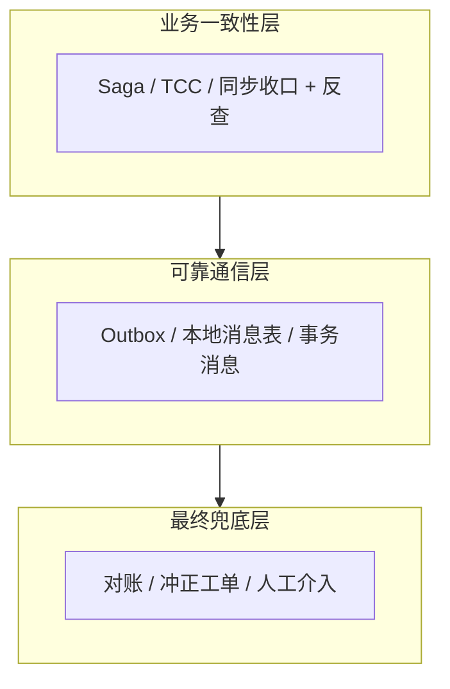
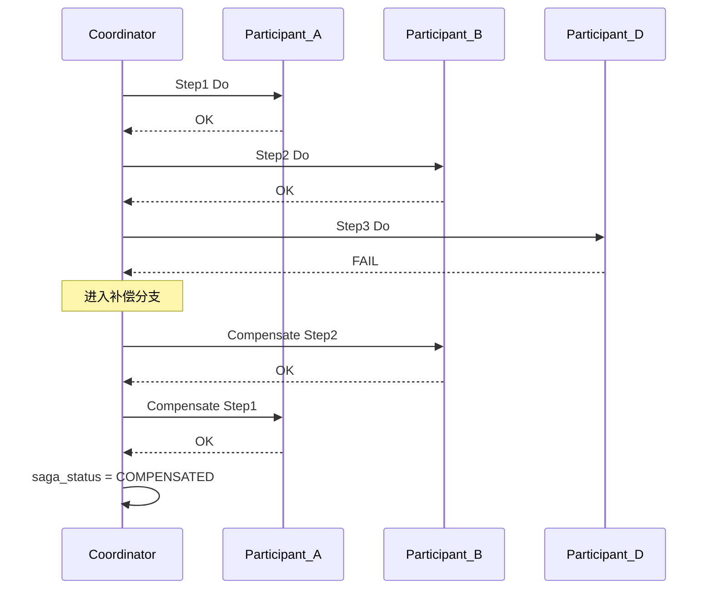
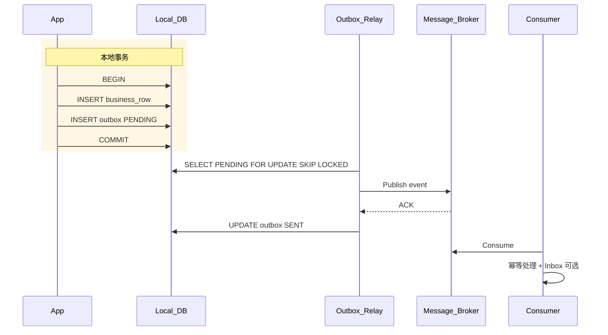
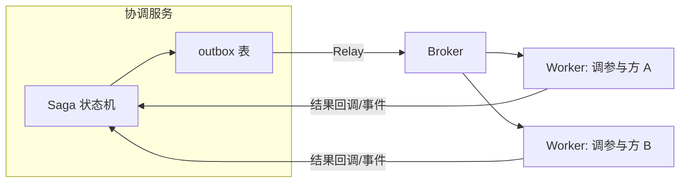
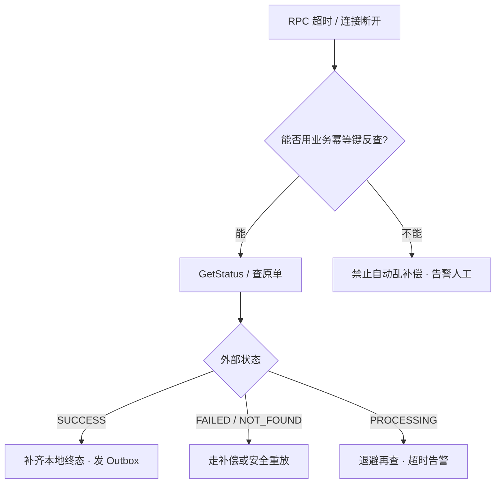

<!-- [skill: go-team-standards · 迁移] 公开正文迁移，保留原文与来源标识。 -->


# 分布式事务深度分析：Saga + Outbox

> **文档定位**：讲清「跨服务一致性」里最常用的组合拳——**Saga（编排/补偿）+ Outbox（可靠投递）**。  
> **刻意剥离**：不绑定理财 / 资产 / 订单等具体域名；用抽象角色（发起方、参与方、资源方）说明。  
> **阅读目标**：知道各自解决什么问题、为何常一起用、失败怎么收、何时不该用。

* * *

## 目录

1.  [问题本质：分布式下没有免费的 ACID](#1-问题本质分布式下没有免费的-acid)
2.  [先分清两层问题](#2-先分清两层问题)
3.  [Saga：业务级长事务与补偿](#3-saga业务级长事务与补偿)
4.  [Outbox：本地提交与对外通知的原子性](#4-outbox本地提交与对外通知的原子性)
5.  [组合拳：Saga + Outbox 如何配合](#5-组合拳saga--outbox-如何配合)
6.  [业务中真实出现的一致性场景（抽象）](#6-业务中真实出现的一致性场景抽象)
7.  [失败模型与恢复策略](#7-失败模型与恢复策略)
8.  [落地骨架（表 / 状态机 / Worker）](#8-落地骨架表--状态机--worker)
9.  [与其它分布式方案对照](#9-与其它分布式方案对照)
10.  [选型决策树与反模式](#10-选型决策树与反模式)
11.  [设计检查清单](#11-设计检查清单)

* * *

## 1\. 问题本质：分布式下没有免费的 ACID

单体时代，一笔业务多表变更可以包在同一个数据库事务里：

```text
BEGIN
  写业务单
  改库存/额度
  记流水
COMMIT   ← 全成或全败
```

拆成微服务后，**每个服务只拥有自己的库**。跨服务调用无法共享同一个 DB 事务。于是出现经典半成功：

<table><thead><tr><th>现象</th><th>含义</th></tr></thead><tbody><tr><td>A 已提交，调 B 超时</td><td>不知道 B 有没有做成</td></tr><tr><td>A、B 都成功，发 MQ 失败</td><td>下游永远收不到事件</td></tr><tr><td>补偿做到一半进程挂了</td><td>留下「中间态」</td></tr></tbody></table>

**分布式事务**在工程上通常不是「恢复 XA」，而是回答三件事：

1.  **前进**：多步怎么按序做完？
2.  **后退**：某步失败，已成功的步骤怎么撤销（或冲正）？
3.  **通知**：本地真相变更后，怎么保证外部一定能感知？

Saga 主要覆盖 1+2；Outbox 主要覆盖 3。二者正交，经常叠加。

* * *

## 2\. 先分清两层问题



<table><thead><tr><th>层级</th><th>典型手段</th><th>解决的问题</th><th>不解决的问题</th></tr></thead><tbody><tr><td>业务一致性</td><td>Saga、TCC、同步原子服务</td><td>多参与方「整体成功或可接受终态」</td><td>事件是否发出</td></tr><tr><td>可靠通信</td><td>Outbox、Inbox、事务消息</td><td>「本地已提交 ⇒ 消息最终可达」</td><td>对方业务是否成功</td></tr><tr><td>最终兜底</td><td>对账、红冲、告警</td><td>漏网差异被发现并抹平</td><td>主路径实时正确</td></tr></tbody></table>

**常见误解**：以为上了 Outbox 就不需要补偿。  
事实：Outbox 只保证「消息发出」；消息消费失败、下游拒绝，仍要 Saga/冲正/重试。

* * *

## 3\. Saga：业务级长事务与补偿

### 3.1 定义

Saga = 一组**本地事务**按序执行；任一步失败，按逆序（或预定义策略）执行**补偿事务**，使系统进入可接受的终态（成功完成或明确失败，而非永久悬挂）。

注意：Saga 追求的是 **业务语义上的一致性（最终一致）**，不是数据库级隔离级别下的全局原子性。执行过程中其它读者可能看到中间态——这是设计时必须接受并产品化处理的点（例如展示「处理中」）。

### 3.2 两种形态

<table><thead><tr><th> </th><th>编排式 Orchestration</th><th>协作式 Choreography</th></tr></thead><tbody><tr><td>谁推进</td><td>中心协调器（服务 / 状态机 / Workflow 引擎）</td><td>各服务听事件自行推进</td></tr><tr><td>优点</td><td>补偿顺序清晰、易观测、易超时治理</td><td>无单点协调器、解耦</td></tr><tr><td>缺点</td><td>协调器成为关键路径</td><td>链路难追、补偿顺序难控、易环依赖</td></tr><tr><td>推荐</td><td><strong>资金/账务类优先编排</strong></td><td>通知、积分、弱一致旁路可用协作</td></tr></tbody></table>

### 3.3 抽象时序（编排式）



### 3.4 补偿设计要点（深度）

1.  **补偿必须幂等**  
    网络重试会导致补偿被调用多次；`Compensate(x)` 第 2 次应返回成功且不产生副作用。
2.  **补偿不是「物理回滚」**  
    很多步骤不可撤销（已发短信、已对外付款）。常见做法是：
    
    -   **冲正**：记一笔反向业务（金额、状态、审计齐全）
    -   **标记作废**：原单 `VOIDED`，不再参与后续计算
    -   **人工工单**：技术无法自动撤销时升级
3.  **空补偿 / 跳过补偿**  
    若某步「只读校验」或「尚未产生外部副作用」，失败时无需补偿，避免假补偿逻辑。
4.  **中间态必须一等公民**  
    状态机至少区分：`PENDING` → `RUNNING` → `SUCCEEDED` \| `COMPENSATING` → `COMPENSATED` \| `FAILED`。  
    「处理中」对用户可见时，要有超时与恢复 Job，否则会永久卡死。
5.  **隔离与并发**  
    Saga 执行期间，其它请求可能读到中间数据。手段：
    
    -   资源预留（接近 TCC 的 Try）
    -   业务锁（按主体维度串行）
    -   语义接受最终一致（展示延迟）

### 3.5 Saga 与「同步收口」的关系

若跨服务变更能收口到**一个具备本地事务的原子服务**（一次 RPC 内完成多账户变更），则可大幅缩短 Saga：

```text
短 Saga：本地落单 → 调原子服务 → 本地终态
长 Saga：本地落单 → 调服务A → 调服务B → 调服务C → …
```

短 Saga 仍需要：**超时反查、幂等键、卡住恢复**——只是步骤更少。

* * *

## 4\. Outbox：本地提交与对外通知的原子性

### 4.1 要解决的经典坑

```text
错误写法：
  BEGIN; 写业务表; COMMIT;
  publish(Kafka);          ← 进程在此崩溃 ⇒ 事件丢失

或：
  publish(Kafka);
  BEGIN; 写业务表; COMMIT; ← 消息已发但本地回滚 ⇒ 幽灵事件
```

### 4.2 Outbox 模式

在**同一本地事务**内：

1.  写业务表（真相）
2.  写 `outbox` 行（待投递事件）
3.  `COMMIT`

另有 **Relay / Worker**（轮询或 CDC）把 `PENDING` 事件投递到 MQ，成功后标记 `SENT`（或删除）。



### 4.3 Outbox 不保证什么

<table><thead><tr><th>Outbox 保证</th><th>Outbox 不保证</th></tr></thead><tbody><tr><td>本地提交后事件最终会被投递（at-least-once）</td><td>恰好一次（exactly-once）语义</td></tr><tr><td>投递顺序在单聚合根内可设计保证</td><td>全局全序</td></tr><tr><td>与业务行同生共死</td><td>消费者一定处理成功</td></tr></tbody></table>

因此消费端必须：

-   **幂等**（业务唯一键 / Inbox 去重表）
-   **可重试**
-   **失败进 DLQ + 告警**

### 4.4 实现变体

<table><thead><tr><th>变体</th><th>做法</th><th>取舍</th></tr></thead><tbody><tr><td>轮询 Outbox 表</td><td>Worker <code>SKIP LOCKED</code> 拉取</td><td>实现简单；有投递延迟</td></tr><tr><td>CDC（如 Debezium）</td><td>听 WAL 变 outbox 行</td><td>延迟低；运维复杂</td></tr><tr><td>事务消息（部分 MQ）</td><td>半消息 + 回查</td><td>少自建表；绑定 MQ 能力</td></tr><tr><td>Inbox</td><td>消费前先落库去重</td><td>防重复消费；多一张表</td></tr></tbody></table>

### 4.5 与「本地消息表」的关系

「本地消息表」与 Outbox **同构**：都是「业务事务内写待发消息」。业界常把二者当同一模式的不同叫法；差别多在投递实现细节。

* * *

## 5\. 组合拳：Saga + Outbox 如何配合

### 5.1 分工一句话

<table><thead><tr><th>组件</th><th>一句话</th></tr></thead><tbody><tr><td><strong>Saga</strong></td><td>管「多步业务做完或退干净」</td></tr><tr><td><strong>Outbox</strong></td><td>管「某步本地成功后，下一步/旁路一定能被驱动」</td></tr></tbody></table>

### 5.2 典型组合拓扑



两种推进方式（可混用）：

1.  **同步推进**：协调器 RPC 调参与方；仅把「领域事件」经 Outbox 发给旁路（通知、审计、读模型）。
2.  **异步推进**：协调器每完成一步只写状态 + Outbox；Worker 消费后调下一参与方，再回写 Saga 状态。

资金敏感路径更常见 **同步推进 + Outbox 发领域事件**；高吞吐批处理更常见 **异步推进**。

### 5.3 组合后的端到端语义

```text
用户请求
  → 协调器开启 Saga（本地事务：写 saga_instance + 业务草稿）
  → 执行 Step N（参与方本地事务）
  → 成功则：更新 saga 进度 + Outbox「StepN_DONE」（同事务）
  → Relay 投递 → 触发 Step N+1 或通知下游
  → 若 Step 失败：进入补偿链（每步补偿同样建议可 Outbox 驱动或同步调用）
  → 终态：SUCCEEDED / COMPENSATED / FAILED_NEED_MANUAL
```

### 5.4 为何「只 Saga 不够」

没有 Outbox 时，协调器常见写法：

```text
更新 saga 状态为 STEP2_READY
publish("do_step2")   ← 崩溃则 Step2 永不触发，Saga 永久卡住
```

有 Outbox：状态与「待执行下一步」同事务落库，崩溃后由 Relay/恢复 Job 续跑。

### 5.5 为何「只 Outbox 不够」

Outbox 保证消息发出，但：

-   参与方执行失败需要**补偿编排**
-   多步依赖顺序与超时策略需要**状态机**
-   半成功需要**反查与冲正**

这些都不是 Outbox 的职责。

* * *

## 6\. 业务中真实出现的一致性场景（抽象）

下列场景刻意去品牌化，对应各域「跨服务改账/改单」的共性。

### 场景 A：双写资源（服务内缓存 + DB）

-   **问题**：先改缓存成功、写库失败 → 缓存脏。
-   **常用解**：同请求内顺序约束 + 失败回滚缓存；或 DB 为真相、缓存可重建；**对账 Job** 兜底。
-   **Saga/Outbox 角色**：通常不需要跨服务 Saga；Outbox 可用于「缓存失效事件」。

### 场景 B：本域落单 + 调外部账务服务

```text
本域：创建业务单 PROCESSING
外部：扣减 / 冻结 / 入账
本域：业务单 SUCCESS + 写流水
```

<table><thead><tr><th>故障点</th><th>处理</th></tr></thead><tbody><tr><td>外部明确失败</td><td>本域标 FAILED；若已占本地资源则补偿释放</td></tr><tr><td>外部超时未知</td><td><strong>禁止盲补偿</strong>；用幂等键反查外部状态，再补做或补偿</td></tr><tr><td>外部成功、本域崩溃</td><td>恢复 Job：反查成功 → 补完成本域终态；写 Outbox 通知</td></tr></tbody></table>

这是 **短 Saga + 幂等反查 +（可选）Outbox** 的高频形态。

### 场景 C：多参与方链式变更

```text
校验 → 预留资源 → 账务变更 → 写业务终态 → 通知
```

任一步失败需逆序释放/冲正 → **编排 Saga**。  
每步成功对外广播 → **Outbox**。

### 场景 D：批处理（计费 / 结算 / 派发）

```text
生成待处理行（幂等唯一键）
  → Outbox / 队列异步执行外部入账
  → 回写成功凭证
  → 失败重试 / DLQ / 次日补偿
```

批处理更依赖：**幂等键 + Outbox/队列 + 对账**；Saga 可简化为「单行状态机」。

### 场景 E：已对外生效后的纠错

技术补偿窗口已过（用户已消费、报表已出）→ **业务冲正单**，而不是回头跑 Saga。  
冲正本身仍建议：本地冲正单 + Outbox 事件 + 外部 Reverse 接口（幂等）。

* * *

## 7\. 失败模型与恢复策略

### 7.1 故障分类

<table><thead><tr><th>类型</th><th>例子</th><th>策略</th></tr></thead><tbody><tr><td>确定性业务失败</td><td>余额不足、状态非法</td><td>立即补偿或拒绝；不要无限重试</td></tr><tr><td>瞬时基础设施失败</td><td>超时、连接重置</td><td>有限次重试 + 退避</td></tr><tr><td>未知结果</td><td>请求已发出，响应丢失</td><td><strong>反查</strong>，禁止假设失败就补偿</td></tr><tr><td>进程崩溃</td><td>停在任意步骤</td><td>恢复 Job 按状态机续跑</td></tr><tr><td>投递失败</td><td>Outbox 长期 PENDING</td><td>老化告警 + 重试 + 人工</td></tr><tr><td>消费失败</td><td>下游持续报错</td><td>DLQ + 熔断 + 工单</td></tr></tbody></table>

### 7.2 「未知结果」是资金类最高危点



**铁律**：对「可能已成功」的外部写操作，补偿前必须先反查；否则可能造成**重复入账或重复扣款**。

### 7.3 恢复 Job 的职责

与 Outbox Relay 互补：

<table><thead><tr><th>组件</th><th>扫什么</th><th>做什么</th></tr></thead><tbody><tr><td>Outbox Relay</td><td><code>outbox.status=PENDING</code></td><td>投递到 Broker</td></tr><tr><td>Saga Recover</td><td><code>saga</code> 超时未终态</td><td>反查参与方、续跑或补偿</td></tr><tr><td>Reconcile</td><td>双边流水/余额差异</td><td>告警、自动抹平或工单</td></tr></tbody></table>

* * *

## 8\. 落地骨架（表 / 状态机 / Worker）

以下为**领域无关**的最小骨架，落地时改 schema 名即可。命名对齐团队惯例：`uid`、`_at TIMESTAMPTZ(6)`、软删 `deleted_at`、金额带业务前缀。

### 8.1 Saga 实例表（示意）

```sql
-- [skill: go-team-standards · 数据库设计] saga 实例表示意（非某域正式 DDL）
CREATE TABLE demo.saga_instances (
    id              BIGINT PRIMARY KEY,
    saga_type       VARCHAR(64)  NOT NULL,  -- 业务编排类型
    biz_key         VARCHAR(128) NOT NULL,  -- 业务幂等键
    current_step    VARCHAR(64)  NOT NULL,
    status          SMALLINT     NOT NULL,  -- 1运行 2成功 3补偿中 4已补偿 5失败待人工
    payload_json    JSONB        NOT NULL,
    created_at      TIMESTAMPTZ(6) NOT NULL,
    updated_at      TIMESTAMPTZ(6) NOT NULL,
    deleted_at      TIMESTAMPTZ(6)
);
-- UNIQUE (saga_type, biz_key) WHERE deleted_at IS NULL
```

### 8.2 Outbox 表（示意）

```sql
CREATE TABLE demo.outbox (
    id              BIGINT PRIMARY KEY,
    aggregate_type  VARCHAR(64)  NOT NULL,
    aggregate_id    VARCHAR(64)  NOT NULL,
    event_type      VARCHAR(64)  NOT NULL,
    payload_json    JSONB        NOT NULL,
    status          SMALLINT     NOT NULL,  -- 1待投递 2已投递 3投递失败
    retry_count     INT          NOT NULL DEFAULT 0,
    next_retry_at   TIMESTAMPTZ(6),
    created_at      TIMESTAMPTZ(6) NOT NULL,
    sent_at         TIMESTAMPTZ(6),
    deleted_at      TIMESTAMPTZ(6)
);
```

### 8.3 同事务写入伪代码

```go
// [skill: go-team-standards · 技术方案] 本地事务内业务行 + outbox
err := db.Transaction(func(tx *gorm.DB) error {
    if err := tx.Create(&bizRow).Error; err != nil {
        return fmt.Errorf("insert biz: %w", err)
    }
    if err := tx.Create(&outboxRow).Error; err != nil {
        return fmt.Errorf("insert outbox: %w", err)
    }
    return nil
})
```

### 8.4 状态机最小集合

```text
NEW
  → RUNNING
      → SUCCEEDED
      → COMPENSATING → COMPENSATED
      → FAILED_RETRYABLE  →（恢复 Job）回到 RUNNING 或 COMPENSATING
      → FAILED_TERMINAL / NEED_MANUAL
```

### 8.5 可观测性必打点

<table><thead><tr><th>指标</th><th>用途</th></tr></thead><tbody><tr><td><code>saga_running_age_seconds</code></td><td>卡住发现</td></tr><tr><td><code>outbox_pending_age_seconds</code></td><td>投递老化</td></tr><tr><td><code>saga_compensate_total</code></td><td>补偿频率异常</td></tr><tr><td><code>outbox_publish_fail_total</code></td><td>Broker/权限问题</td></tr><tr><td>日志字段 <code>trace_id</code> / <code>saga_id</code> / <code>biz_key</code></td><td>串联排查</td></tr></tbody></table>

* * *

## 9\. 与其它分布式方案对照

<table><thead><tr><th>方案</th><th>一致性强度</th><th>锁/阻塞</th><th>业务改造</th><th>典型用途</th></tr></thead><tbody><tr><td>本地事务</td><td>强</td><td>短</td><td>无</td><td>单服务单库</td></tr><tr><td>2PC / XA</td><td>强</td><td>高</td><td>中</td><td>极少；同资源管理器</td></tr><tr><td>TCC</td><td>较强（预约）</td><td>中（预留）</td><td>高（三接口）</td><td>强预留场景</td></tr><tr><td><strong>Saga</strong></td><td>最终 + 补偿</td><td>低</td><td>中（补偿逻辑）</td><td>跨服务长流程</td></tr><tr><td><strong>Outbox</strong></td><td>通信可靠</td><td>低</td><td>低</td><td>事件必达</td></tr><tr><td>事务消息</td><td>通信可靠</td><td>低</td><td>中</td><td>绑定特定 MQ</td></tr><tr><td>同步原子服务 + 反查</td><td>边界内强</td><td>低</td><td>中</td><td>资金收口</td></tr><tr><td>对账 + 冲正</td><td>最终</td><td>无</td><td>低～中</td><td>一切方案的兜底</td></tr></tbody></table>

**Saga + Outbox** 的定位：在放弃全局 2PC 的前提下，用**可补偿的业务流程** + **可靠的状态推进/通知**，换取可扩展的微服务架构。

* * *

## 10\. 选型决策树与反模式

### 10.1 决策树

```text
变更是否只在一个服务的一个库？
  ├─ 是 → 本地事务（不要 Saga）
  └─ 否
       能否收口到一个原子写服务？
         ├─ 是 → 同步调用 + 幂等 + 超时反查（短链路）；旁路事件用 Outbox
         └─ 否
              参与方是否支持「预留 → 确认/取消」？
                ├─ 是 → 优先 TCC
                └─ 否 → 编排 Saga + 补偿
                     每步成功是否需要驱动下一步或通知外部？
                       └─ 是 → 叠加 Outbox（或等价可靠投递）
务必保留：对账 / 冲正 / 人工终态
```

### 10.2 反模式

<table><thead><tr><th>反模式</th><th>为何有害</th><th>正确做法</th></tr></thead><tbody><tr><td>先发 MQ 再写库</td><td>幽灵消息</td><td>Outbox：先同事务落库</td></tr><tr><td>超时即补偿</td><td>可能重复冲正已成功外部操作</td><td>先反查</td></tr><tr><td>补偿不可幂等</td><td>重试放大资金事故</td><td>补偿与正向共用幂等键</td></tr><tr><td>无中间态 / 无恢复 Job</td><td>永久卡单</td><td>状态机 + Recover</td></tr><tr><td>用 Outbox 替代业务补偿</td><td>消息到了业务仍可能失败</td><td>分层设计</td></tr><tr><td>协作式 Saga 做资金主路径</td><td>难追责、难补偿排序</td><td>资金用编排</td></tr><tr><td>忽略对账</td><td>静默资金漂移</td><td>定期双边核对</td></tr></tbody></table>

* * *

## 11\. 设计检查清单

写某域技术方案涉及跨服务写时，逐项打勾：

**Saga**

-   \[ \] 步骤列表与成功条件写清
-   \[ \] 每步补偿动作写清（含「无需补偿」）
-   \[ \] 补偿与正向均幂等
-   \[ \] 超时 / 未知结果走反查，不盲补偿
-   \[ \] 状态机含中间态与人工终态
-   \[ \] 有 Recover Job 与告警阈值

**Outbox**

-   \[ \] 业务行与 outbox 同行同事务提交
-   \[ \] Relay 使用 `SKIP LOCKED` 或等价租约，防多实例抢同一行
-   \[ \] at-least-once + 消费端幂等
-   \[ \] PENDING 老化告警、失败重试上限、DLQ
-   \[ \] payload 含足够溯源字段（`biz_key` / `trace_id`）

**兜底**

-   \[ \] 对账口径与差异阈值
-   \[ \] 冲正 / 人工路径
-   \[ \] 禁止用 float 金额；时间 UTC `_at`

* * *

## 附录 A：概念速查

<table><thead><tr><th>术语</th><th>含义</th></tr></thead><tbody><tr><td>本地事务</td><td>单库 ACID 事务</td></tr><tr><td>补偿</td><td>抵消已成功步骤副作用的业务操作</td></tr><tr><td>冲正</td><td>记账意义上的反向单据（常用于不可物理回滚）</td></tr><tr><td>幂等</td><td>同一业务键执行任意次，效果与一次相同</td></tr><tr><td>at-least-once</td><td>至少投递一次，允许重复</td></tr><tr><td>Inbox</td><td>消费端去重落库</td></tr><tr><td>DLQ</td><td>死信队列，承接反复失败消息</td></tr></tbody></table>

## 附录 B：一页纸结论

```text
┌─────────────────────────────────────────────────────────┐
│  Saga     = 多步业务的前进 + 失败补偿（业务一致性）      │
│  Outbox   = 本地提交与对外事件的绑定（通信可靠性）      │
│  组合     = 状态机推进不丢、旁路通知不丢                │
│  仍需要   = 幂等 · 反查 · 恢复 Job · 对账 · 冲正        │
│  不要用   = 把 Outbox 当分布式事务；超时盲补偿          │
└─────────────────────────────────────────────────────────┘
```

* * *
