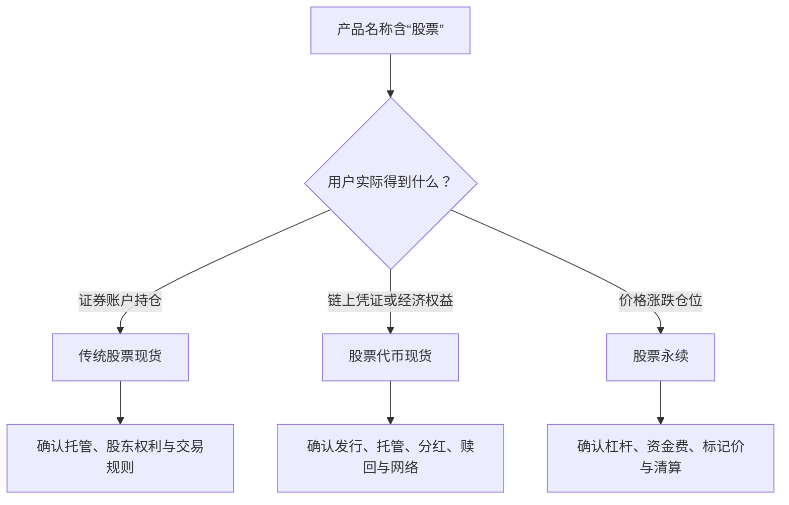
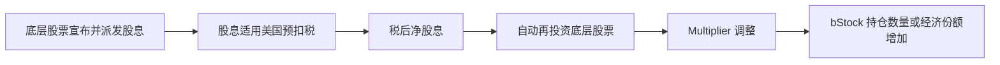
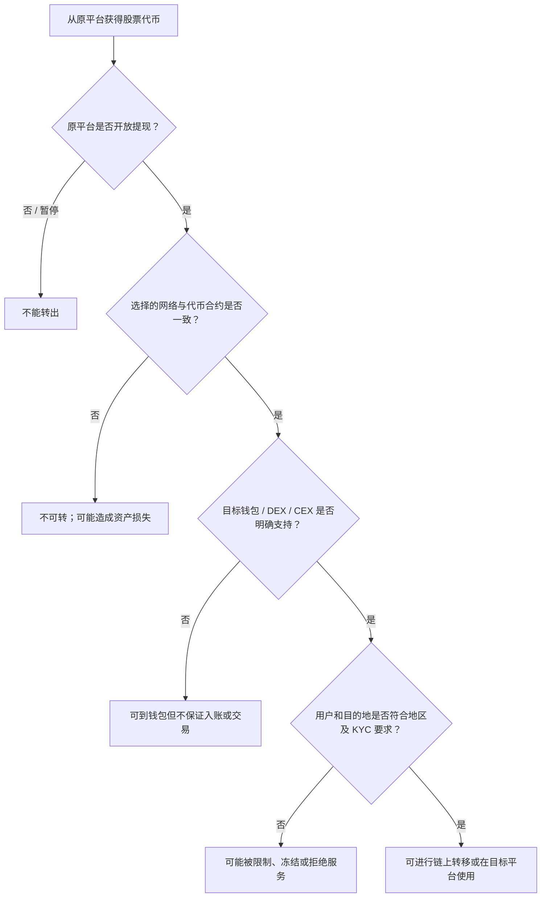
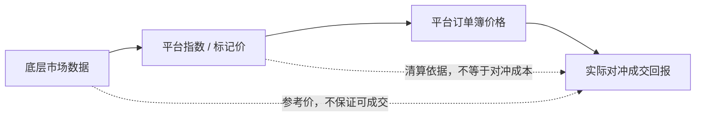
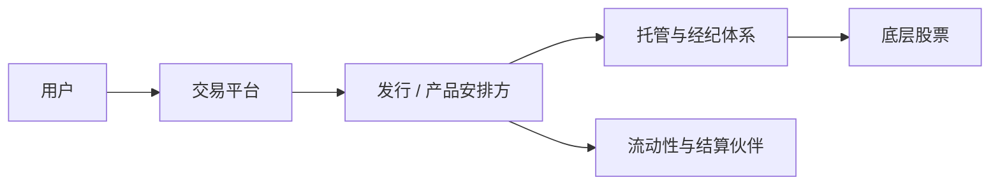
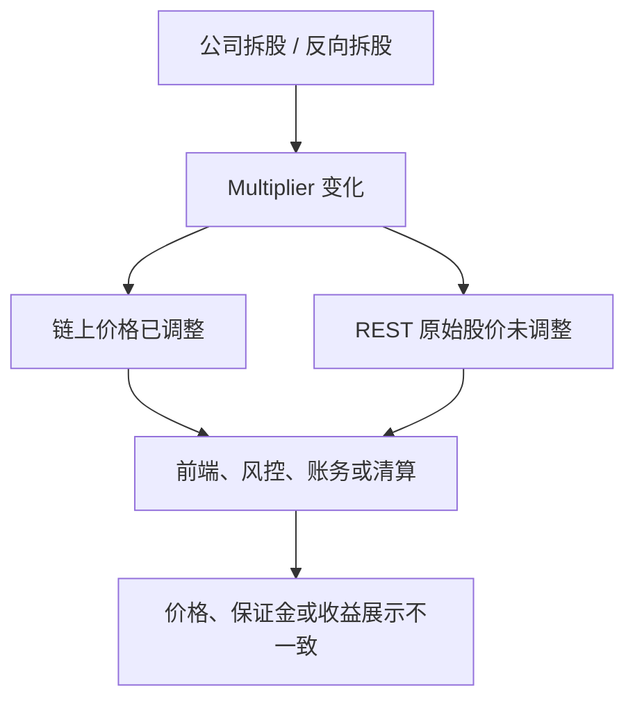

<!-- [skill: go-team-standards · 迁移] 公开正文迁移，保留原文与来源标识。 -->

## 目录

1.  [执行摘要](#1-执行摘要)
2.  [产品分类与判断框架](#2-产品分类与判断框架)
3.  [用户决策清单](#3-用户决策清单)
4.  [竞品规则与对照](#4-竞品规则与对照)
5.  [市场时段、定价与风险控制](#5-市场时段定价与风险控制)
6.  [事故复盘](#6-事故复盘)
7.  [产品信息架构与文案规范](#7-产品信息架构与文案规范)
8.  [外链资料索引](#8-外链资料索引)

* * *

## 1\. 执行摘要

名称中都带有“股票”的产品，可能属于完全不同的资产结构：传统证券账户中的股票、由托管资产支持的链上经济权益，或仅跟踪价格的永续合约。

因此，产品说明不能只写“支持股票交易”或“1:1 锚定股票”。必须明确：

1.  用户持有的是股票、经济权益凭证，还是价格合约。
2.  是否具有分红、投票、赎回和公司行动权益。
3.  是否可转出，及其网络、合约地址、地区和平台兼容性限制。
4.  是否有杠杆、资金费、强平与休市定价机制。
5.  发行、托管、流动性、定价与交易平台分别承担什么责任。

### 1.1 核心边界

<table><thead><tr><th>不能直接划等号</th><th>原因</th></tr></thead><tbody><tr><td><code>1:1 支持</code> = <code>登记股东</code></td><td>支持方式可能是托管资产对应的经济权益，不当然赋予直接股权或投票权。</td></tr><tr><td><code>可提钱包</code> = <code>跨平台通用</code></td><td>目标平台还必须支持同一网络、同一合约资产与适用的合规范围。</td></tr><tr><td><code>余额增加</code> = <code>现金分红</code></td><td>余额变化可能来自再投资或 multiplier 调整。</td></tr><tr><td><code>24/7 可交易</code> = <code>价格质量稳定</code></td><td>传统市场关闭时，流动性、参考价与可对冲能力可能显著下降。</td></tr><tr><td><code>股票永续</code> = <code>拥有股票</code></td><td>永续合约提供价格敞口，不提供股票交割或常规股东权益。</td></tr></tbody></table>

* * *

## 2\. 产品分类与判断框架

### 2.1 三类产品

<table><thead><tr><th>类别</th><th>用户买到什么</th><th>权益重点</th><th>交易与风险重点</th></tr></thead><tbody><tr><td>传统股票现货</td><td>证券账户中的股票持仓</td><td>股东权利、券商托管、公司行动</td><td>证券市场交易时段与券商规则</td></tr><tr><td>股票代币现货</td><td>链上代币或对托管股票的经济权益记录</td><td>分红、赎回、网络、兼容性、地区限制</td><td>发行与托管、提现、链上合约、公司行动</td></tr><tr><td>股票永续</td><td>跟踪股票价格的衍生合约仓位</td><td>通常不含股票分红或投票权</td><td>杠杆、资金费、标记价、休市保护与强平</td></tr></tbody></table>

### 2.2 判断流程

### 2.3 研究原则

-   先回答用户取得什么，再解释平台如何实现。
-   已公开的规则附上来源；未公开信息明确标为“未公开”或“待核验”。
-   单一产品规则不可推导至其他标的、其他地区或其他平台。
-   历史事件用于检查产品机制，不应被包装为无法证实的因果结论。

* * *

## 3\. 用户决策清单

<table><thead><tr><th>问题</th><th>必须披露的内容</th></tr></thead><tbody><tr><td>我买到了什么？</td><td>真实股票、托管股票的经济权益，还是价格合约仓位。</td></tr><tr><td>我有哪些权益？</td><td>分红、投票、赎回、拆股、合并等公司行动如何处理。</td></tr><tr><td>资产能否转出？</td><td>钱包、网络、最低提现金额、网络费与暂停条件。</td></tr><tr><td>能否换平台使用？</td><td>目标平台是否支持同一合约地址、网络及合规范围。</td></tr><tr><td>可以如何交易？</td><td>现货、做空、杠杆、保证金、借贷、资金费与强平规则。</td></tr><tr><td>何时可以交易？</td><td>正盘、盘前、盘后、周末与休市期间的交易和价格规则。</td></tr><tr><td>出问题由谁负责？</td><td>发行、托管、转换、预言机、流动性和交易平台的责任边界。</td></tr></tbody></table>

* * *

## 4\. 竞品规则与对照

### 4.1 Binance bStocks

根据 [Binance bStocks 官方说明](https://academy.binance.com/ur-PK/articles/what-are-bstocks-a-guide-to-tokenized-stocks-on-binance)：

-   bStocks 是链上证券型凭证，官方说明其对应资产由受监管托管方持有。
-   用户获得底层股票的价格表现与部分经济权益，不等同于直接登记持有底层股票。
-   资产为 BNB Smart Chain 上的 BEP-20 代币，可在兼容钱包中自托管。
-   股息并非以现金或稳定币直接支付：扣除适用预扣税后的净额自动再投资，并通过 multiplier 机制调整持仓数量。
-   官方页面写明当前美国预扣税为 30%；实际适用性应以用户资格、法律文件和当期产品规则为准。
-   提现网络为 BNB Smart Chain；网络费、最低提现数量和转账限制可能随标的变化。

#### 4.1.1 重点：股息、预扣税与买卖不是一回事

> **结论**：公开规则将当前 30% 美国预扣税绑定在“底层股票派息”这一公司行动上，而不是 bStock 的买入、卖出、法币兑换或普通链上转账。

<table><thead><tr><th>场景</th><th align="right">这笔 30% 股息预扣税是否触发</th><th>说明</th></tr></thead><tbody><tr><td>买入 bStock</td><td align="right">否</td><td>公开规则未将股息预扣税设为买入环节收费。</td></tr><tr><td>卖出 bStock</td><td align="right">否</td><td>公开规则未将股息预扣税设为卖出环节收费。</td></tr><tr><td>兑换为法币或其他资产</td><td align="right">否</td><td>公开规则未将股息预扣税设为兑换环节收费。</td></tr><tr><td>底层股票派息</td><td align="right">是</td><td>股息先按适用规则预扣，再将税后净额自动再投资。</td></tr><tr><td>不派息</td><td align="right">否</td><td>没有股息，就没有这笔股息预扣税。</td></tr></tbody></table>

**经济承担方式**：从用户的经济结果看，持有人承担的是“少获得税前股息中的预扣部分”；平台公开说明没有写明具体哪一法律主体作为法定扣缴或申报方，因此不应擅自归因给 Binance、发行方或托管方。

**示例（仅说明机制，不构成收益预测）**：若底层股票除息前为 100 美元、每股现金股息为 1 美元，按当前公开的 30% 预扣规则，约 0.7 美元进入再投资。若除息后股价相应减少约 1 美元，则持仓的税后经济价值约为 99.7 美元；约 0.3 美元差额体现为预扣税造成的税后回报拖累，而不是单独显示为 bStock 的“溢价”。

**重要边界**：以上仅解释 bStocks 公布的美国股息预扣税机制。交易费、价差、网络费，以及用户所在地对买卖收益可能征收的资本利得税或其他税，属于另一套规则，不能据此认定“买卖完全免税”。

#### 4.1.2 能否上链与自托管

可以。依据当前公开说明，bStocks 是部署在 **BNB Smart Chain** 上的 **BEP-20** 代币，用户可以将其提现至兼容 BNB Smart Chain 的个人钱包；因此它可以在链上转移并被兼容的第三方协议集成。

但“能上链”不等于“无条件自由流通”：

-   当前公开提现网络为 BNB Smart Chain；使用其他网络可能造成资产损失。
-   目标平台必须支持相同的资产、合约和网络，才能正确入账或交易。
-   提现可能受最低数量、网络费、智能合约控制、制裁筛查与适用法律限制。
-   发行方保留按产品规则限制或冻结不符合资格地址的权利；地区与用户资格限制仍然适用。

**准确文案**：

> bStocks 是由托管资产支持的链上证券型凭证，提供底层股票的价格表现与相应经济权益。它不等同于直接登记持有底层公司股票；投票权、赎回权、适用地区和公司行动处理以产品规则为准。  
> bStocks 是由托管资产支持、部署在 BNB Smart Chain 上的链上证券型凭证，提供底层股票的价格表现与相应经济权益。它不等同于直接登记持有底层公司股票；股息先按适用预扣税处理，税后净额再通过 multiplier 反映到持仓中。投票权、赎回权、适用地区、转出和公司行动处理以产品规则为准。

### 4.2 Binance 股票永续

根据 [Binance 股票永续官方说明](https://academy.binance.com/ur-PK/articles/how-to-trade-stock-perpetual-contracts-on-binance)：

-   股票永续是跟踪底层股票价格的衍生合约，不代表持有底层股票。
-   官方材料说明其以 USDT 结算，并采用资金费机制维持价格锚定。
-   页面列示的最大杠杆为 10 倍；资金费每八小时结算，具体参数应以交易页当期规则为准。
-   底层股票市场关闭时，产品仍可能交易；指数和标记价会采用专门机制，应单独向用户披露。

**准确文案**：

> 股票永续提供股票价格的合约敞口，不提供股票交割、投票权或常规股息权益。用户应重点理解杠杆、资金费、标记价、休市机制和强平条件。

### 4.3 Bitget rToken

根据 [Bitget rToken 官方说明](https://www.bitget.com/en-CA/support/articles/12560603887176)：

-   rToken 提供与股票或 ETF 经济价值挂钩的链上资产。
-   官方明确表示，持有 rToken 不等同于直接登记持有股票，通常不包含投票权。
-   对符合条件的用户，合资格净现金分红可转换为 USDT 并单独入账。
-   产品的地区、身份验证、资产支持范围及生态可用能力应按账户和标的逐项确认。

### 4.4 对照结论

<table><thead><tr><th>产品</th><th>属性</th><th>分红</th><th>转出 / 通用性</th><th>核心风险</th></tr></thead><tbody><tr><td>Binance bStocks</td><td>股票代币现货</td><td>净额再投资并调整数量</td><td>BNB Smart Chain 提现；跨平台需目标平台支持</td><td>发行、托管、网络与公司行动</td></tr><tr><td>Binance 股票永续</td><td>股票价格合约</td><td>不享有常规股票分红</td><td>合约仓位不可提现至钱包</td><td>杠杆、资金费、标记价与强平</td></tr><tr><td>Bitget rToken</td><td>股票经济权益代币</td><td>合资格净现金分红以 USDT 处理</td><td>具体网络和账户能力待逐项确认</td><td>地区限制、产品资格与权益边界</td></tr></tbody></table>

### 4.5 跨平台对照：是否上链、能否转到其他平台

> **阅读方法**：`可上链` 只表示资产存在于某条链上；`可转出` 只表示可以从原平台提出；`可在其他平台使用` 则同时要求目标钱包、DEX 或 CEX 支持**同一链、同一合约地址、同一代币标准及适用的地区合规规则**。三者不是同义词。

<table><thead><tr><th>平台 / 产品</th><th>用户取得的美股权益</th><th align="right">是否公开为链上代币</th><th align="right">当前可转至自托管钱包</th><th align="right">能否转至其他平台</th><th>公开规则与限制</th></tr></thead><tbody><tr><td>Binance bStocks</td><td>托管股票支持的经济权益；非直接登记持股</td><td align="right">是，BSC 上的 BEP-20</td><td align="right">是，仅支持 BNB Smart Chain</td><td align="right">有条件</td><td>目标平台必须支持同一 bStock 与 BSC；提现受最低数量、网络费、合规及智能合约控制限制。</td></tr><tr><td>Kraken xStocks</td><td>1:1 支持的代币化股票 / ETF 敞口；具体权利以发行文件为准</td><td align="right">是</td><td align="right">是</td><td align="right">原则上可</td><td>xStocks 官网称可自托管、链上交易；发行方资料称其在 Solana、Ethereum、Mantle、TON 和 Ink 上发行，且可自由链上转移。目标平台是否入账仍须先核对。</td></tr><tr><td>Robinhood Stock Tokens</td><td>由 Robinhood Assets 发行的债务型证券；提供经济敞口，非直接或受益所有权</td><td align="right">是，Robinhood Chain</td><td align="right">是，兼容指定自托管钱包</td><td align="right">有条件</td><td>官方说明支持钱包、DEX 和部分 CEX 场景；但不能据此推断所有交易所均支持 Robinhood Chain 上的对应代币。</td></tr><tr><td>Bitget rToken</td><td>1:1 支持的股票 / ETF 经济权益；通常不含直接股票所有权或投票权</td><td align="right">发行方称为链上 RWA</td><td align="right"><strong>当前不可确认可提</strong></td><td align="right">当前不可确认</td><td>Bitget 于 2026-07-01 暂停 rToken 提现，恢复时间待公告；其后链上与钱包整合仍处于“将推出”状态。站内买卖不等于可外部转移。</td></tr><tr><td>MSX RWA Spot</td><td>平台称为链上 RWA 股票代币；具体法律权利须逐标的核验</td><td align="right">平台宣称“on-chain”</td><td align="right">未公开到可核验的网络与提现规则</td><td align="right">未公开</td><td>官方页面提到钱包整合、直接转账和跨链费用，但未见足以核验的具体链、合约地址及外部 CEX 入账规则；应标为待核验。</td></tr></tbody></table>

#### 4.5.1 跨平台转移的真实判断流程

#### 4.5.2 各平台的关键差异

-   **Binance bStocks**：链上能力和 BSC 自托管路径已公开，但网络单一，且跨平台兼容性依赖目标平台支持。
-   **Kraken xStocks**：公开的多链与可自由转移能力最明确，适合研究“代币能否作为开放链上资产流通”；不过用户资格和地区限制依然存在。
-   **Robinhood Stock Tokens**：链上和钱包使用已公开，但资产是债务型证券；它的“可转移”不能被理解为对任何交易所的通用充值支持。
-   **Bitget rToken**：上链发行和储备证明已公开，但外提处于暂停与后续整合状态；当前最不能把“链上 RWA”直接写成“已可跨平台流通”。
-   **MSX**：主张链上 RWA 与钱包转账，但要进入竞品结论前，仍需取得具体标的的合约地址、支持网络、提现规则和目标平台入账证据。

#### 4.5.3 结论模板

> 本产品是否“支持上链”应至少拆成四项说明：发行网络、是否可提现、是否可自托管、目标平台是否支持入账或交易。除非平台公开列出同一链与同一合约地址的兼容性，否则不得将“可上链”表述为“可跨平台通用”。

### 4.6 Binance Stocks 与传统券商：快速参考

> 本节用于理解产品结构，不构成开户、投资或税务建议。不同国家 / 地区、账户实体、标的和时间点的可用性、费用及资产保护可能不同，应以开户文件与当期规则为准。

#### 4.6.1 Binance 体系内的两类股票产品

<table><thead><tr><th>维度</th><th>Binance Stocks</th><th>Binance bStocks</th></tr></thead><tbody><tr><td>产品性质</td><td>Binance 账户内的股票交易业务线，由 Nest Trading Limited 与外部券商合作提供</td><td>链上证券型凭证 / 代币化证券</td></tr><tr><td>用户持有关系</td><td>官方说明为股票的受益所有人；持仓由券商合作方托管</td><td>获得底层股票的价格表现与经济权益，不是直接登记持股</td></tr><tr><td>分红与公司行动</td><td>可享分红并参与适用公司行动，具体按股票业务规则处理</td><td>股息税后净额自动再投资，并通过 multiplier 调整；公司行动按代币规则处理</td></tr><tr><td>是否上链</td><td>不应默认上链</td><td>是，当前公开为 BNB Smart Chain 的 BEP-20 代币</td></tr><tr><td>与另一产品的关系</td><td>合资格的 Binance Stocks 持仓可在体系内转换为对应 bStock</td><td>可反向转换回 Binance 体系内的股票持仓；转换资格和可用性以产品规则为准</td></tr><tr><td>外部转仓</td><td>未见公开资料确认支持将其他券商的既有美股持仓直接转入</td><td>可向兼容 BNB Smart Chain 的钱包提现；不等于所有交易所支持入账</td></tr></tbody></table>

**一句话区分**：Binance Stocks 更接近通过券商合作方托管的股票账户；bStocks 是可上链、可自托管的代币化经济权益产品。两者可在 Binance 体系内连接，但法律权利与跨平台流通能力不同。

#### 4.6.2 与常见美国券商的结构对照

<table><thead><tr><th>类型 / 示例</th><th>核心结构</th><th>更适合用来对照什么</th><th>与 Binance Stocks 的主要不同点</th></tr></thead><tbody><tr><td>传统 / 互联网券商：Fidelity、Charles Schwab、Interactive Brokers</td><td>直接券商账户模式，证券交易、托管、对账和转仓通常处于券商体系内</td><td>股票所有权、账户转移、交易市场、费用和投资者保护</td><td>Binance Stocks 通过 Nest Trading 与券商合作提供服务，开户实体、资金路径、支持范围和转仓安排需要单独核对</td></tr><tr><td>移动优先券商：Robinhood、Webull</td><td>面向个人投资者的线上券商账户模式</td><td>移动端体验、碎股、订单和账户规则</td><td>不应与 Robinhood 的链上 Stock Tokens 混为一谈；后者是另一种代币化证券结构</td></tr><tr><td>银行 / 财富管理关联券商：E*TRADE、Merrill Edge、Vanguard</td><td>证券账户通常与银行、资管或基金生态结合</td><td>现金管理、基金、退休账户和账户整合</td><td>Binance Stocks 的优势在于加密资产资金路径与 bStocks 转换，不等同于传统银行 / 资管产品体系</td></tr></tbody></table>

> 美国证券账户的一般投资者保护取决于实际开户的券商实体及其清算安排。美国 SEC 的投资者教育材料提示，SIPC 可能在 SIPC 成员券商破产或无法履责时保护账户内现金与证券，但不保障市场价格下跌造成的损失。境外实体或代币化证券是否适用该机制，不能根据品牌名称推断。

#### 4.6.3 开户或研究前的核对项

1.  实际开户实体、清算 / 托管实体及所在司法辖区。
2.  用户是否取得直接或受益股票权利，还是仅取得经济权益凭证。
3.  是否支持证券转仓；若支持，支持哪些标的、账户类型和地区。
4.  现金、证券和代币化资产分别适用何种投资者保护与破产隔离安排。
5.  交易费、点差、换汇费、网络费、公司行动费用与税务处理。
6.  bStock 转换、提现、钱包兼容性与回转为股票持仓的限制。

* * *

## 5\. 市场时段、定价与风险控制

### 5.1 时段差异

<table><thead><tr><th>时段</th><th>典型特征</th><th>产品控制建议</th></tr></thead><tbody><tr><td>盘前</td><td>参与者和累计深度通常较少</td><td>缩减报价量、扩大保护边界</td></tr><tr><td>正盘</td><td>传统股票价格锚和对冲能力通常最强</td><td>使用标准报价与风控参数</td></tr><tr><td>盘后</td><td>财报等事件集中，深度可能变薄</td><td>动态深度、滑点和限仓控制</td></tr><tr><td>周末 / 假日</td><td>底层市场关闭，参考源可能停止更新</td><td>收盘锚定、降杠杆、限仓或只平仓</td></tr></tbody></table>

延长时段的风险背景可参考 [Nasdaq 交易时段说明](https://www.nasdaq.com/market-activity/stocks/trged/after-hours-trades) 和 [FINRA 延长时段风险提示](https://www.finra.org/investors/insights/extended-hours-trading)。

### 5.2 四层价格链路

<table><thead><tr><th>价格层</th><th>回答的问题</th><th>不能替代什么</th></tr></thead><tbody><tr><td>底层市场数据</td><td>证券市场参考价是多少</td><td>不保证加密市场可在此价格成交</td></tr><tr><td>平台指数 / 标记价</td><td>合约如何估值和触发清算</td><td>不代表实际对冲成本</td></tr><tr><td>外部订单簿</td><td>当前可见价格和数量</td><td>委托可能撤单或部分成交</td></tr><tr><td>实际成交回报</td><td>最终对冲数量与滑点</td><td>才是库存与损益的真实入账价格</td></tr></tbody></table>

### 5.3 小平台接入股票永续的最小控制集

<table><thead><tr><th>风险</th><th>后果</th><th>最小控制</th></tr></thead><tbody><tr><td>休市价格失真</td><td>异常标记价触发强平</td><td>多源参考、收盘锚定带、平滑标记价；单笔成交不可直接触发强平</td></tr><tr><td>报价深度未缩量</td><td>用户成交后无法以相近价格对冲</td><td>取时段系数、外部累计深度与库存余量的最小值</td></tr><tr><td>只看一档深度</td><td>低估滑点、撤单与回补成本</td><td>统计累计深度、成交率、撤单率、P95 滑点和回补时间</td></tr><tr><td>参考源与对冲场所错配</td><td>名义锚定但实际存在基差</td><td>逐标的维护乘数、结算币、资金费、交易时段与公司行动映射</td></tr><tr><td>薄市叠加高杠杆</td><td>连锁强平与坏账</td><td>阶梯保证金、限仓降杠杆、价格带、只平仓与人工熔断</td></tr></tbody></table>

* * *

## 6\. 事故复盘

### 6.1 Binance 停止旧版 Stock Tokens（2021）

**已核验事实**

-   [Reuters / Euronews 报道](https://www.euronews.com/next/2021/07/16/us-crypto-currency-binance)称，Binance 在监管审查加剧的背景下停止销售旧版 Stock Tokens，并宣布后续终止支持。
-   报道提到用户在限定窗口内可持有或出售相关产品；服务终止后，交易与平仓能力将受到限制。

**风险拆解**

1.  **监管可用性风险**：技术可运行不代表产品可在所有地区持续提供。
2.  **退出路径风险**：停止销售、只平仓、停止交易、赎回 / 转换和最终结算必须分别定义。
3.  **资产连续性风险**：产品下线时，如何估值、如何处理未完成公司行动和用户剩余资产必须预先约定。
4.  **沟通风险**：仅在公告或 FAQ 中说明退出规则，会使用户误判产品仍可长期持有或迁移。

**产品整改清单**

-   上线前定义完整生命周期：上线、限制新增、只平仓、停止交易、赎回 / 转换、最终结算。
-   为每个阶段披露用户动作、时间、价格来源和费用。
-   在交易页、站内信与邮件中提供多渠道通知。
-   保留订单、持仓、分红和公司行动的可导出记录。
-   按司法辖区维护独立的可用性和退出策略。

### 6.2 Bittrex Global 停止 Stokens（2022）

**已核验事实**

-   [Bittrex Global 公告](https://bittrexglobal.zendesk.com/hc/en-us/articles/10386585350171-Important-announcement-regarding-Tokenized-Stocks-or-Stokens)称，该平台曾通过与 Alameda 的历史关系提供 Stokens。
-   在 FTX 与 Alameda 困难消息出现后，平台暂停交易，随后决定关闭该产品。
-   公告称将向用户补偿 Stokens 持仓的全额价值，并与监管方和法律顾问合作追索相关股票价值。

**风险链路**

**复盘结论**

底层是股票并不意味着风险只来自股票价格。发行、托管、流动性、结算和平台本身构成独立风险链。任一环节失效，都可能影响交易、提现、转换、分红、估值和最终处置。

**最小控制要求**

<table><thead><tr><th>风险点</th><th>必须具备的控制</th></tr></thead><tbody><tr><td>单一发行或结算伙伴</td><td>替代路径、集中度上限和应急切换方案</td></tr><tr><td>关键服务方角色不透明</td><td>产品页披露发行、托管、流动性和交易职责</td></tr><tr><td>紧急暂停交易</td><td>预先定义估值、补偿、通知与申诉流程</td></tr><tr><td>用户不清楚资产性质</td><td>明确区分股票所有权、经济权益和合约敞口</td></tr><tr><td>对手方违约后的估值不清</td><td>独立估值、估值冻结和结算优先级规则</td></tr></tbody></table>

### 6.3 Robinhood multiplier 口径差异

**事件性质**：这不是平台宕机，而是公司行动后可能使前端、账务、风控和清算产生不一致的数据口径风险。

根据 [Robinhood Stock Token API 文档](https://docs.robinhood.com/chain/stock-token-apis/)：

-   REST `/prices` 返回底层股票原始 bid / ask，不按 multiplier 调整。
-   链上 Chainlink 价格源使用 multiplier 调整后的值。
-   混用两类价格时，需要使用 `/assets` 中的 `currentMultiplier` 换算。
-   拆股等公司行动会影响 multiplier；文档提供 corporate actions 接口用于追溯变化。

**最小控制要求**

1.  每个标的维护唯一的 canonical price 与 canonical multiplier。
2.  前端、订单、风险引擎和账务使用同一版本号。
3.  公司行动前对高风险交易能力降级或冻结。
4.  将拆股、反向拆股、分红、合并等事件写入可追溯事件表。
5.  对调整前后执行总价值守恒校验。
6.  在 UI 中解释数量变化来源，避免被误解为现金收益。

### 6.4 薄市与强平：待核验线索

对于缺少充分一手证据的市场异常，不应写成已确认事故；但可作为必须验证的风险问题：

-   单笔异常成交是否直接影响标记价？
-   底层市场关闭时，参考价是否停更？
-   报价深度是否随外部深度自动缩量？
-   是否存在单标的价格带、限仓、只平仓与人工熔断？
-   强平是否采用可解释、可审计且抗操纵的标记价？

可参考 [OKX 股票永续 FAQ](https://www.okx.com/en-us/help/stock-perpetuals-faq) 了解独立订单簿与传统市场关闭时的指数、标记价机制；该资料用于研究机制，不替代对特定产品条款的核验。

* * *

## 7\. 产品信息架构与文案规范

### 7.1 产品详情页字段

<table><thead><tr><th>字段</th><th>必须写清楚的内容</th></tr></thead><tbody><tr><td>资产性质</td><td>股票、证券型凭证或衍生合约</td></tr><tr><td>发行与托管</td><td>责任主体、托管方式、资产隔离情况</td></tr><tr><td>用户权益</td><td>分红、投票、赎回与公司行动处理</td></tr><tr><td>交易方式</td><td>现货、杠杆、永续、借贷、资金费与强平</td></tr><tr><td>价格机制</td><td>底层价格、指数、标记价与休市规则</td></tr><tr><td>交付与转出</td><td>网络、合约地址、最低金额、费用与兼容性</td></tr><tr><td>可用范围</td><td>司法辖区、用户资格、KYC 与产品限制</td></tr><tr><td>风险与退出</td><td>暂停交易、只平仓、下线、结算与争议处理</td></tr></tbody></table>

### 7.2 推荐首屏说明

> **你买到的是什么？**  
> 本产品为【传统股票 / 股票代币现货 / 股票永续】。用户获得的是【直接股票持有 / 经济权益凭证 / 价格合约敞口】。是否提供分红、投票、赎回、提现及其具体限制，以本页产品规则为准。

### 7.3 禁用表达与替换表达

<table><thead><tr><th>避免使用</th><th>建议使用</th></tr></thead><tbody><tr><td>买这个就是买美股</td><td>该产品提供与底层股票相关的【直接持仓 / 经济权益 / 价格敞口】。</td></tr><tr><td>1:1 支持，所以等同持股</td><td>由对应资产支持，但不当然构成直接登记持股。</td></tr><tr><td>能提钱包，所以可跨平台交易</td><td>可转出不代表目标平台支持同一资产、网络或合规范围。</td></tr><tr><td>有分红，所以拥有股东权利</td><td>分红可能是经济权益安排，不等同于投票或直接股东身份。</td></tr><tr><td>24/7 交易，所以价格一直可靠</td><td>传统市场关闭时，价格质量、流动性、指数和标记价机制可能不同。</td></tr></tbody></table>

* * *

## 8\. 外链资料索引

### 8.1 产品与监管教育

-   [SEC / Investor.gov：Tokenized Securities](https://www.investor.gov/introduction-investing/investing-basics/investment-products/tokenized-securities)
-   [Nasdaq：延长交易时段](https://www.nasdaq.com/market-activity/stocks/trged/after-hours-trades)
-   [FINRA：Extended-hours Trading](https://www.finra.org/investors/insights/extended-hours-trading)

### 8.2 平台产品规则

-   [Binance：What Are bStocks?](https://academy.binance.com/ur-PK/articles/what-are-bstocks-a-guide-to-tokenized-stocks-on-binance)
-   [Binance：What Is Binance Stocks Trading?](https://academy.binance.com/ur-PK/articles/what-is-binance-stocks-trading)
-   [Binance：How to Trade Stock Perpetual Contracts](https://academy.binance.com/ur-PK/articles/how-to-trade-stock-perpetual-contracts-on-binance)
-   [OKX：股票永续规则](https://www.okx.com/zh-hans/help/stock-perpetuals)
-   [MSX：RWA Dividend Calendar](https://msx.com/zh-hans/trade/rwa/dividend-calendar)
-   [Bitget：rToken、分红、费用与交易时间](https://www.bitget.com/en-CA/support/articles/12560603887176)
-   [Kraken：xStocks](https://www.kraken.com/gb/xstocks)
-   [xStocks：合作与多链集成说明](https://xstocks.com/partner)
-   [Robinhood：Stock Tokens](https://robinhood.com/rhj/stocktokens/)
-   [Bitget：rToken 暂停提币公告](https://www.bitget.com/zh-CN/support/articles/12560603887770)
-   [MSX：链上 RWA 股票平台说明](https://msx.com/)
-   [SEC / Investor.gov：Brokers](https://www.investor.gov/introduction-investing/getting-started/working-investment-professional/brokers)
-   [Robinhood：Stock Token API](https://docs.robinhood.com/chain/stock-token-apis/)

### 8.3 事故与机制资料

-   [Reuters / Euronews：Binance 停止旧版 Stock Tokens](https://www.euronews.com/next/2021/07/16/us-crypto-currency-binance)
-   [Bittrex Global：Stokens 重要公告](https://bittrexglobal.zendesk.com/hc/en-us/articles/10386585350171-Important-announcement-regarding-Tokenized-Stocks-or-Stokens)
-   [OKX：TradFi / Stock Perpetuals FAQ](https://www.okx.com/en-us/help/stock-perpetuals-faq)
