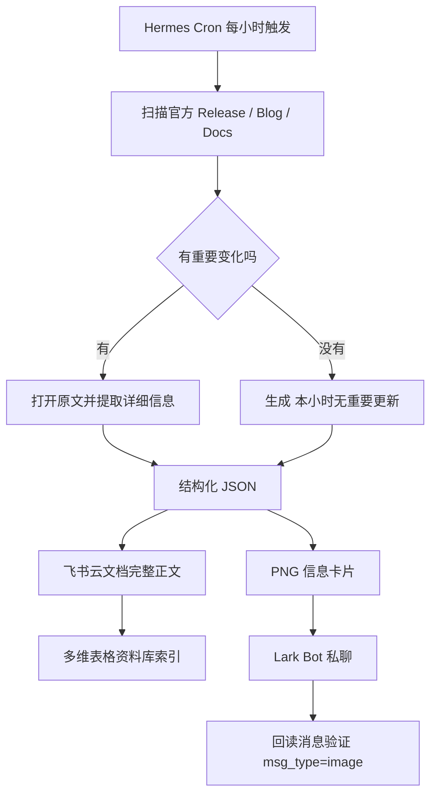

<!-- [skill: go-team-standards · 迁移] 公开正文迁移，保留原文与来源标识。 -->


一开始，我以为这件事很简单：每小时搜一次 AI Agent 新闻，生成一张图片，再发到 Lark。

第一版确实跑起来了。图片也能收到。但认真检查后，我发现它只是“定时生成图片”，并不是一套情报系统。

真正有用的情报至少要回答六个问题：

-   发生了什么；
-   它解决了什么问题；
-   具体怎么实现；
-   谁在推进；
-   目前是稳定版、测试版还是提案；
-   为什么值得我现在关注。

而且，图片只是阅读入口。完整正文要能追溯，历史记录要能搜索，任务重跑不能制造一堆重复数据。于是我把整个流程重做了一遍。

## 最终效果

现在，这个任务会在每个整点自动执行：

```text
获取资讯
  → 打开官方原文获取详细信息
  → 生成结构化 JSON
  → 渲染中文竖版信息卡片
  → 写入飞书云文档
  → 在多维表格建立索引
  → 通过 Lark Bot 私聊发送图片
  → 回读消息确认发送成功
```

Hermes 本身支持周期任务、Skill、独立运行会话和多种投递目标，因此适合承担调度与推理部分。1

这里最关键的改动不是多调用了几个 API，而是把验收标准从“生成了一张图”改成“六步全部有可验证结果”。

## 系统架构




_Hermes 官方 Session Orchestrator。定时任务、独立会话和执行状态最终都需要落到可观察的运行单元。_

我把系统拆成四个职责明确的脚本：

```text
render_hourly_intel.py   JSON → 1080×1540 PNG
archive_hourly_intel.py  JSON → 云文档 + 多维表格索引
send_lark_image.py       PNG → Lark 私聊 + 消息回读
Cron Agent               检索、筛选、深挖、组织内容
```

Agent 只处理需要判断的部分。渲染、归档和发送都交给确定性脚本，失败时可以明确知道是哪一步出错。

## 第一步：获取资讯，但不要急着写摘要

检索范围固定为：

```text
AI Agent / MCP / CLI 工具 / 自动化 / 开源项目
```

来源优先级也固定：

1.  官方 GitHub Releases；
2.  官方博客；
3.  官方文档；
4.  项目维护者公开说明；
5.  二手媒体只用于发现线索，不作为关键结论的唯一来源。

每轮先广泛扫描，再保留最多三条。没有重要变化时，报告直接写“本小时无重要更新”。为了凑够三条而填入低价值新闻，只会把情报系统变成新的信息噪声。

第一版在这里犯过一个错误：它读取搜索结果里的标题和摘要后就开始写卡片。搜索摘要只能告诉你“可能有这件事”，不能回答它的机制、成熟度和适用边界。

## 第二步：打开官方原文，补全六个字段

每条入选资讯都要进入详情页，提取下面这些信息：

```json
{
  "what": "它是什么",
  "problem": "解决什么问题",
  "mechanism": "怎么做到",
  "who": "谁在做",
  "maturity": "stable / beta / prerelease / proposal",
  "relevance": "为什么与我有关",
  "url": "官方原始链接"
}
```

例如，某个 CLI Agent 发布了“用户验收后自动停止”的修复。只写“修复停止问题”没有用。详细信息里要说清楚：

-   触发条件是任务完成并被用户接受；
-   旧行为是 Agent 仍可能继续执行；
-   新行为是在接受事件后结束 Autopilot；
-   当前版本是否为 prerelease；
-   对现有自动化系统意味着什么。

这样生成的内容才能进入资料库。否则存进去的只是新闻标题。


_Hermes 官方 Skills Hub。检索规范、引用规则和 Lark 交付流程适合沉淀为可复用 Skill，而不是每轮重新描述。_

## 第三步：先建立结构化数据，再渲染

我没有让 Agent 直接写图片，而是先生成一份 JSON：

```json
{
  "report_id": "2026-09-17-02",
  "generated_at": "2026-09-17T02:32:00+09:00",
  "title": "Agent 终于学会：用户说完成，就该停手",
  "summary": "本小时结论",
  "original_urls": [
    "https://github.com/example/project/releases/tag/v1.2.3"
  ],
  "items": [
    {
      "rank": "01",
      "title": "资讯标题",
      "body": "卡片短文",
      "what": "完整说明",
      "problem": "要解决的问题",
      "mechanism": "实现机制",
      "who": "项目或团队",
      "maturity": "prerelease",
      "relevance": "与用户的关系",
      "url": "https://github.com/example/project/releases/tag/v1.2.3"
    }
  ],
  "action": "本小时建议"
}
```

这份 JSON 是整条流水线的契约：

-   图片读取 `title`、`body` 和 `source`；
-   云文档读取完整详情字段；
-   多维表格读取标题、摘要、标签和文档链接；
-   后续如果要生成网页、邮件或周报，不需要重新抓取原始信息。

## 第四步：把摘要做成手机可读的信息卡片

图片使用固定的 `1080×1540` 画布，最多放三条信息。每条卡片只保留：

```text
变化是什么
当前处于什么阶段
为什么值得关注
```

完整机制不应该硬塞进图片。手机屏幕不是文档编辑器，字太多只会让人放弃阅读。

中文字体也值得单独检查。macOS 上某些日文字体可以显示大部分汉字，但会出现缺字方框。我最后固定使用系统自带的简体中文字体：

```python
FONT_REG = "/System/Library/Fonts/STHeiti Light.ttc"
FONT_BOLD = "/System/Library/Fonts/STHeiti Medium.ttc"
```

每张图生成后至少检查四件事：缺字、截断、重叠、文字越过卡片边界。脚本返回成功，只能证明 PNG 文件存在，不能证明它在手机上能看。

## 第五步：云文档存正文，多维表格存索引


这是整套方案里最容易被误解的地方。

云文档和多维表格不是二选一，它们分别解决不同的问题：

<table><thead><tr><th>存储</th><th>保存内容</th><th>用途</th></tr></thead><tbody><tr><td>飞书云文档</td><td>原始链接、结论、六字段详情、行动建议</td><td>阅读完整内容、保留上下文</td></tr><tr><td>多维表格“资料库”</td><td>标题、类型、文档链接、摘要、标签、状态</td><td>搜索、筛选、去重、建立索引</td></tr></tbody></table>

Lark Open Platform 提供云文档创建与多维表格记录写入 API，可以由独立应用完成这两个动作。3

每份小时报告会创建一篇云文档，文档顶部先写原始链接，然后按资讯逐条展开：

```text
原始链接
结论
详细信息
  01｜标题
  是什么
  解决什么
  怎么做到
  谁在做
  当前阶段
  与你的关系
  来源
本小时动作
```

写完后，脚本重新读取文档块并核对数量。随后在“资料库”表中写入一条索引记录，再回读标题和状态字段。

只有同时满足下面三个条件，归档才算成功：

```text
archived=true
document_verified=true
record_verified=true
```

## 幂等：重跑不能复制一份垃圾

定时任务一定会重跑。网络超时、模型失败、Lark API 短暂错误，都可能让同一个小时执行两次。

我的做法是为每份报告生成稳定的 `report_id`：

```text
2026-09-17-02
```

归档脚本维护一份本地索引：

```json
{
  "reports": {
    "2026-09-17-02": {
      "document_id": "[REDACTED]",
      "record_id": "[REDACTED]"
    }
  }
}
```

首次执行时创建文档和表格记录；再次执行时覆盖原文档内容，并更新同一条记录。这样可以修正报告，又不会让资料库里出现五条相同标题。

凭据完全不进入 JSON、日志和 Prompt。用于文档与多维表格的应用也和聊天 Bot 分开：

```text
FEISHU_KB_APP_ID
FEISHU_KB_APP_SECRET
FEISHU_KB_DOMAIN
```

这种隔离很有必要。聊天 Bot 只负责发消息，知识库应用只负责文档和数据库。任何一边泄露，影响范围都更小。

## 第六步：Lark 发送以后必须回读

发送流程不是“调用上传 API，然后假设成功”，而是：

```text
上传 PNG
  → 获取 image_key
  → 发送 image 消息
  → 获取 message_id
  → 读取该消息
  → 确认 msg_type=image
```

最终验收字段是：

```json
{
  "uploaded": true,
  "sent": true,
  "verified": true,
  "msg_type": "image"
}
```

这一步还解决了一个实际问题：配置里的群聊可能已经失效。发送脚本会优先使用 Hermes 最近真实收到消息的 Lark 私聊路由；如果 Bot 已退出旧群聊，就改用经过验证的用户 `open_id`。所有 ID 都从本地会话状态或 Lark 响应中读取，不猜，也不打印。

## Cron 要写成验收清单，而不是一句愿望

Hermes Cron 的任务运行在新会话里，因此关键步骤必须写进自包含 Prompt，不能依赖当前聊天的上下文。\[2\]

下面这种 Prompt 太松：


_Hermes 官方配置界面。定时任务的行为设置与凭据应分开管理，Prompt 里只保留流程和验收条件。_

```text
每小时搜索 AI Agent 新闻，生成图片发给我。
```

更可靠的写法是把流程和成功条件全部列出来：

```text
1. 检索官方来源。
2. 对入选资讯读取官方原文。
3. 生成符合固定字段的 JSON。
4. 渲染 1080×1540 PNG 并检查可读性。
5. 运行归档脚本，要求三个 verified 字段为 true。
6. 运行 Lark 发送脚本，要求 msg_type=image。
任一步失败，报告具体阶段，不得声称完成。
```

调度表达式是：

```cron
0 * * * *
```

表示每个整点运行。

## Token 成本比我预想的夸张

这套任务的第一轮完整 Agent Cron 实测消耗了 `480,043` Token，其中绝大多数是输入 Token。这个数字只代表当时那套环境，但它暴露了一个问题：每小时启动完整 Agent、加载大量工具、Skill 和上下文，成本可能远高于图片渲染本身。

我先做了一个简单处理，把 Cron 工具集限制为：

```text
web + terminal
```

更彻底的方案是两级触发：

```text
零 Token 脚本检查 GitHub Release / RSS 时间戳
  → 没变化：直接退出
  → 有变化：才唤醒 Agent 深挖并生成报告
```

Hermes 官方也提供 no-agent Cron：脚本直接决定是否输出，不经过 LLM，因此可以做到零模型 Token。\[2\]

对于每小时监控，这种结构更合理。大部分小时没有重要变化，没必要让大模型重新读一遍世界。


_Hermes 官方系统运维界面。Cron 是否成功，不能只看“已调度”，还要区分检索、归档、发送和回读各阶段。_

## 三个最值得记住的坑

第一，搜索结果不是详细信息。没有打开原文，就不要写机制、成熟度和升级建议。

第二，生成图片不是任务完成。图片、云文档、多维表格和 Lark 消息各自有独立验收结果，少一个都只能算部分成功。

第三，定时 Agent 的 Prompt 必须像运行手册。新会话不知道你上一轮说了什么，也不会自动继承你脑子里的验收标准。

## 结语

这套系统真正有价值的地方，不是“AI 每小时给我发一张图”。

它把零散资讯变成了一个可以持续积累的个人情报库：图片负责快速扫一眼，云文档保留完整细节，多维表格负责搜索和管理，Lark 负责把结果送到手边。

当每一步都有结构化输入、明确输出和回读验证后，Agent 才不再像一个偶尔灵光一现的聊天机器人，而更像一条能长期运行的个人信息流水线。

## Sources

\[1\] [https://github.com/NousResearch/hermes-agent](https://github.com/NousResearch/hermes-agent) — NousResearch/hermes-agent  
\[2\] [https://hermes-agent.nousresearch.com/docs/user-guide/features/cron](https://hermes-agent.nousresearch.com/docs/user-guide/features/cron) — Hermes Scheduled Tasks (Cron)  
\[3\] [https://open.larksuite.com/document/server-docs/docs/docs/docx-v1/document/create](https://open.larksuite.com/document/server-docs/docs/docs/docx-v1/document/create) — Lark Create Document API  
\[4\] [https://open.larksuite.com/document/server-docs/docs/bitable-v1/app-table-record/create](https://open.larksuite.com/document/server-docs/docs/bitable-v1/app-table-record/create) — Lark Create Bitable Record API
